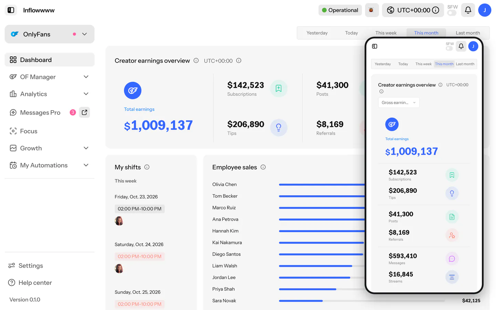

# Inflowwww

Inflowwww is a free, open-source, self-hosted alternative to Infloww for
OnlyFans agencies. A Python relay (FastAPI) holds each captured OnlyFans web
session and signs and replays its API calls; a Next.js app is the dashboard.
It covers the inbox and chat, fans, mass messages, the vault, statistics,
team (chatters and employees), settings, and auto post / auto story.
Rebuilding the full Infloww UI on top of this base is in progress; see
[VISION.md](VISION.md).



## Quick start

Requires Docker Engine 25+ with Compose 2.20+ (the healthchecks use `start_interval`).

```bash
git clone <this repo> openinflowwww && cd openinflowwww

# openinflowwww-app joins the external network n8n_default; it must exist.
docker network create n8n_default

# Bind-mounted state. proxies.json must exist as a file, not a directory.
# The SQLite DB lives in service/data/ (created on first boot, with its -wal/-shm).
echo '{"proxies": []}' > service/proxies.json
mkdir -p service/data service/sessions

# Compose reads .env beside docker-compose.yml. Nothing in it is strictly
# required: without SHARE_TOKEN the share-link gate is off (sign-in is the
# only gate), and without the session secrets every rebuild signs all users out.
cat > .env <<ENV
SHARE_TOKEN=$(openssl rand -hex 24)
SESSION_SECRET=$(openssl rand -hex 32)
CHATTER_SESSION_SECRET=$(openssl rand -hex 32)
DEEPSEEK_API_KEY=
INFLOWW_PROXIES=
ENV

docker compose up -d --build
```

This starts `openinflowwww-relay` (127.0.0.1:8787), `openinflowwww-app`
(127.0.0.1:3001) and `openinflowwww-autoheal`. Open
`http://127.0.0.1:3001/?t=<SHARE_TOKEN>`; the token is remembered after the
first visit. Then add an OnlyFans account by capturing a session with the
extension in `loginExtensionMulti/` (or the desktop app).

Fill `DEEPSEEK_API_KEY` (the AI key) and `INFLOWW_PROXIES` (the OnlyFans
proxy pool, comma-separated `host:port:user:pass`; format in `docs/proxies.md`)
in that `.env` on the server. It is gitignored: keys and proxy credentials live
only there and must never be committed. `service/.env.example` documents every
variable.

Optional variables for `.env`: `ADMIN_PASSWORD` (without it, founder-only
actions return 503) and the LLM keys `DEEPSEEK_API_KEY`,
`DEEPINFRA_API_KEY`, `ZAI_API_KEY` (the dashboard works without them).

The app shows Infloww's screens plus "My Automations". The older automation
pages (`/automations` and the Settings > Legacy tabs) are gone; an old
`/automations` link lands on My Automations.

`openinflowwww-tunnel` is a Cloudflare quick tunnel in the `tunnel` profile. It
needs no token or account and does not start unless you ask for it:
`docker compose --profile tunnel up -d`. It prints a random
`trycloudflare.com` URL that changes on every restart. To install on a VPS,
use `deploy/deploy-here.sh`, which does the steps above for you.

**Upgrading an install from before 2026-10-29** (DB at `service/chatterly.db`):
the DB now lives in the directory `service/data/`, so its `-wal` stays on the
host. Move it once, before the first `up` on the new compose, or the relay
starts on an empty DB (`deploy/deploy-here.sh` does this itself):

```bash
docker compose stop openinflowwww-relay && git pull
test -s service/chatterly.db && test ! -e service/data/chatterly.db && mkdir -p service/data &&
  rm -f service/data/chatterly.db-wal service/data/chatterly.db-shm &&
  mv service/chatterly.db service/data/chatterly.db &&
  { docker cp openinflowwww-relay:/app/service/chatterly.db-wal service/data/ 2>/dev/null && echo "carried the last writes" || true; }
docker compose up -d --build
```

The `docker cp` takes the writes the old container still held, if any.

## Surfaces

- Web: the Next.js app in `app/`.
- Phone: the same web app, which is responsive. There is no native app.
- Desktop: an Electron shell in `desktop/` (`npm install && npm start`). It
  asks for your server URL on first launch and loads the web UI from there.

## Repository layout

- `app/`: Next.js dashboard. Proxies API calls to the relay.
- `service/`: FastAPI relay: OnlyFans signing, sessions, proxies, SQLite store, automations.
- `desktop/`: Electron desktop shell.
- `deploy/`: on-server installer (`deploy-here.sh`).
- `scripts/`: dev and ops scripts.
- `docs/`: project notes, ADRs and specs.
- `web/`: Eleventy parody marketing site, built by `pnpm -C web build` and deployed by GitHub Pages. Not served by the relay.
- `fansly/`: Fansly client, imported by the relay for Fansly accounts.
- `loginExtensionMulti/`: Chrome extension that captures an OnlyFans (and Fansly) session.

See [VISION.md](VISION.md) for scope.

## Disclaimer

This project is an independent reverse-engineering of OnlyFans' public web API
for personal / educational use. Running it against a live account may violate
OnlyFans' Terms of Service. Use at your own risk. The project is not affiliated
with or endorsed by OnlyFans.

## License

MIT. See [LICENSE](LICENSE).
