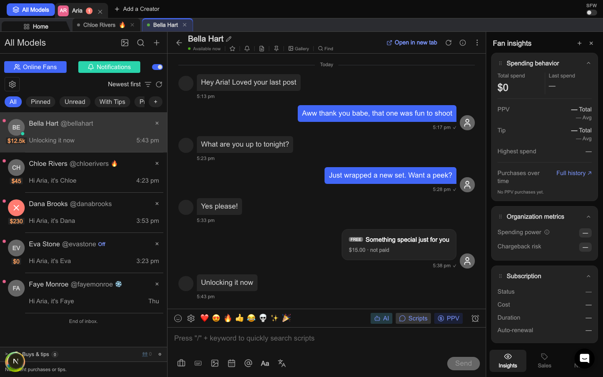

# Messages Pro compare page

Measured at `fe3011c85700dc0de1ab6bcb5fea11e5660b384f` (Legacy flag off unless a row says otherwise). Re-pinned by ticket 152 to the graded code commit, ticket 151's landing: the Ours and Status cells and the Colour inventory's `<basename>:<line>` cells read that commit, and the shots are ticket 151's last default run on it. Phase 0 first measured at `8bf2381102006fdd0d5d87d33b15fc3b9a59e99f`.

Viewports: 1440×900 for every row, and 390×844 for the phone rows (TH2's phone half, CP6, CP7). The harness shots render in `'Sora Fallback'`, because the harness refuses the Sora download (`docs/ui-shots.md:73-75`); the Clone shot renders in the same fallback stack, so type sizes compare and glyph shapes don't.

Both shots come from one ordinary `scripts/ui-shots.sh` run at the measured commit (`messages-pro-report.json` `ok=True`, no new state). Spec: `docs/spec/messages-pro-look-and-feel/phase-00-measure-and-pin.md`.

Page-parity 07 (2026-10-19, Ticket `pp-07`) re-measured its rows (SH4-SH7, FL12-FL17, CH6-CH8, CP8-CP12, FI1) on the shots of a fresh `scripts/ui-shots.sh` run on branch `pp-07-messages-pro`, against the Infloww capture of 2026-10-18. That run's report is `ok=False` on 17 checks that fail on `main` too: the in-app shell checks ("Toggle sidebar, the time zone and Account menu sit in the Window header", `check_sidebar`, `check_app_accent_outside`, "the Top bar is shown below lg"), stale since Messages Pro became its own window (6befcfa7) and the shell parity (cb85008e), and the 13 "same colours under data-theme=light" checks, stale since a7d7300e gave Messages Pro a light palette.

<table>
<tr><th>Ours (Messages Pro)</th></tr>
<tr>
<td></td>
</tr>
</table>

The Clone's shot (`clone-messages-pro.png`) was deleted with the Clone in cleanup Phase 2; tag `legacy-ui-final` keeps both.

How to read a row:

- **Clone px** cites `messages.html:<line>` or `messages.js:<line>` (both under `ui-redesign/infloww-exact/`, deleted in cleanup Phase 2; tag `legacy-ui-final`). "Capture: <value> (wins)" is the real Infloww desktop capture of 2026-10-12 where it disagrees with the Clone (a 2× Retina shot of a 1512px window: device px halved to CSS px, colours sampled on plain fills with `python3 -I` and PIL). "(overridden by plan)" marks a capture colour the plan's binding decisions overrule. Phone rows with no Clone counterpart give the constraint, "fits 390". The captures are never committed and no text from them is quoted here.
- **Ours** cites a key of the Geometry token module (`app/lib/messagesPro.ts`, written `messagesPro.ts` `<region>.<key>`), our literals (`app/lib/messagesProOurs.ts`), a `file:line` under `app/components/chat/` unless a path is given, or a named shot. Colours are the dark `@theme` values in `app/app/globals.css`.
- **Difference** gives the target (Infloww's layout) first and today's state second.
- **Status** is `differs`, `matched` (equal to the target within 1 CSS px, or the same hex as rendered) or `ours` (Infloww has no counterpart). A ticket flips only its own rows; once its Phase has landed, a `differs` row names what is left in Ours as `remaining: <n>px — <reason>`.

## Compare rows

| ID | Region | Difference | Clone px | Ours | Ticket | Status |
|---|---|---|---|---|---|---|
| CO1 | Fan List, Composer | Target: Infloww's blue accent on the active filter chip, Online Fans and the active Send. Today: our purple App accent | `--blue` #4166f6 (`messages.html:13`), `.chip.active` (`:144`), `.btn-online` (`:124`); Capture: Online Fans and the active All chip #4166f6 (agrees) | `bg-accent` at `FanListButtons.tsx:57`, `FanListFilters.tsx:530`, `ComposerToolbar.tsx:213`, reading the palette's `--color-accent` #4166f6 (`InflowwPalette.tsx:36`); harness check "CO1 the Fan List's Online Fans button is Infloww's accent #4166f6" ok in `messages-pro-report.json` (ticket 133) | 133 | matched |
| CO2 | message list | Target: outgoing bubbles blue. Today: purple | `.bubble.out` `var(--blue)` #4166f6 (`messages.html:246`, `:13`); Capture: #353535 (overridden by plan) | `bg-accent` #4166f6 (`MessageList.tsx:838`, `InflowwPalette.tsx:36`); harness check "CO2 our own message bubble is Infloww's blue #4166f6" ok (ticket 133) | 133 | matched |
| CO3 | message list | Target: incoming bubbles Infloww grey. Today: our blue-black | `.bubble.in` #2b2b2b (`messages.html:245`); Capture: #262626 on the incoming bubble body (wins) | `var(--inf-bubble-in)` #262626 (`MessageList.tsx:839`, `InflowwPalette.tsx:59`); harness check "CO3 the Fan's message bubble is Infloww's grey #262626" ok (ticket 133) | 133 | matched |
| CO4 | message list | Target: the PPV card grey with a grey price line. Today: the PPV card is our purple outgoing bubble and its "not paid" price line is our dim blue-grey | `.ppv-mini` #232323 with border #2f2f2f (`messages.html:248`); unpaid `.paid-tag` `var(--muted)` #8a8a8a (`messages.js:888`, `messages.html:22`); no PPV card in either capture | `var(--inf-ppv)` #232323 with `var(--inf-ppv-border)` #2f2f2f (`MessageList.tsx:835-838`, `InflowwPalette.tsx:60-61`); price line `var(--inf-unpaid)` #8a8a8a (`PpvStatus.tsx:22-23`, `InflowwPalette.tsx:62`); unlock bar `bg-accent-hover` #4166f6 (`PpvStatus.tsx:41`, `InflowwPalette.tsx:37`); the three CO4 harness checks ok (ticket 133) | 133 | matched |
| CO5 | Window header, Fan List, Chat header, Composer, Fan insights | Target: Infloww's near-black shell. Today: our blue-black shell | `--win` #0d0d0d (`messages.html:27`), `--topbar` #171717 (`:26`), `--thread` #151515 (`:18`), `--panel` #232323 (`:17`); Capture: Window header #0d0d0d, Fan tabs row #2b2c30, Fan List and Thread #151515, Fan insights pane #0d0d0d with #232323 blocks over the Clone's `.card` #1c1c1c (`:295`) (wins) | `var(--inf-window)` #0d0d0d (`WindowHeader.tsx:42`), `var(--inf-tabs-row)` #2b2c30 (`FanTabsRow.tsx:26`), `var(--inf-pane)` #151515 (`FanList.tsx:799`), `bg-bg` #151515 behind the Thread (`ChatSurface.tsx:817`), `var(--inf-insights)` #0d0d0d (`FanDrawer.tsx:418`) with `var(--inf-card)` #232323 blocks (`FanDrawer.tsx:968`), values at `InflowwPalette.tsx:27`, `:46-55`; the six CO5 harness checks ok (ticket 133) | 133 | matched |
| CO6 | Fan List, Chat header, Composer | Target: Infloww's divider grey on row dividers, pane borders and the Chat header and Composer rules. Today: our blue-grey border | `--border` #2e2e2e (`messages.html:20`), `.conv` border #262626 (`:159`); Capture: #444444 row dividers, Fan List border, Chat header and Composer rules (wins) | `var(--inf-rule)` #444444 on rows (`FanRow.tsx:130`), panes and rules (`InflowwPalette.tsx:45`); harness check "CO6 a Fan List row divider #444444" ok (ticket 133) | 133 | matched |
| CO7 | Fan List, Chat header, message list | Target: Infloww's primary and dim text greys. Today: our blue-white and blue-grey | `--text` #ffffff (`messages.html:21`), `--muted` #8a8a8a (`:22`), `.cprev` muted (`:182`); Capture: names and bubble text #d9d9d9, handles, times and the date label #999999 (wins) | `text-fg` #d9d9d9 and `text-fg-dim` #999999 (`InflowwPalette.tsx:31-32`) at `FanRow.tsx:214`, `:246`, `:249`; harness checks "CO7 a Fan name (primary text) #d9d9d9" and "CO7 a Fan row's preview (dim text) #999999" ok, and every CO check again ok under `data-theme=light` (ticket 133) | 133 | matched |
| SH1 | Window header | Target: at desktop width Messages Pro hides the Top bar, so the Window header is the first row, at y 0. Today: the 56px Top bar sits above it and the Window header starts at y 56 | `.topstrip` is the first row of `.app`, 46px (`messages.html:50-53`, markup `:582`); Capture: Infloww's top strip is the window's first row (agrees) | from lg up `app/components/shell/AppShell.tsx:65` (`noTopBar`) drops the Top bar on Messages Pro (`:97`), so `WindowHeader.tsx:42` is the first row; harness check "no Top bar above the Window header: its top is 0 and no banner is visible" ok, Window header at y 0 in `messages-pro-desktop.png` (ticket 135) | 135 | matched |
| SH2 | Window header | Target: the sidebar toggle, clock and avatar at the Window header's right end, after SFW and the Extras overflow. Today: they sit in the Top bar | `.top-right` gap 14px at the strip's right end (`messages.html:70`, markup `:598-607`); the Clone holds SFW, the language box and the window icon there | `WindowHeader.tsx:64-69`: after SFW and the Extras overflow, the sidebar toggle, `TimeZoneLabel` and `AvatarMenu`, in the app at desktop only (not in a Pop-out window); `messagesPro.ts` `windowHeader.right` gap-3.5; harness check "Toggle sidebar, the time zone and Account menu sit in the Window header" ok (ticket 135) | 135 | matched |
| SH3 | Window header | Target: the language box and the picture-in-picture window icon at the Window header's right end. Today: neither exists (Phase 1 Out of Scope, plan premise stale) | `.tr-box` padding 5px 8px, radius 8px, 17px icon (`messages.html:75-76`, markup `:600-603`); `.icon-btn` 26px, 18px icon (`:77-79`, markup `:604-606`) | none in `WindowHeader.tsx:42-72` | unowned | differs |
| SH4 | Window header | Target: Infloww's top strip height. Today: the Clone's | `.topstrip` 46px (`messages.html:51`); Capture: 48px including the window controls (wins) | `messagesPro.ts` `windowHeader.bar` h-11 (44px with its rule), y 0-43 in `messages-pro-desktop.png` (commit 342d3ca3); the capture's 48px includes the OS window controls | pp-07 | matched |
| SH5 | Fan tabs | Target: Infloww's second row height. Today: the Clone's | `.hometabs` 34px (`messages.html:82`); Capture: 32px (wins) | `messagesPro.ts` `fanTabs.bar` h-8 (32px), y 44-75 in `messages-pro-desktop.png` (commit 342d3ca3) | pp-07 | matched |
| SH6 | Creator tabs | Target: the Creator tab's unread count in Infloww's mint badge with dark text. Today: our status blue with white text (ticket 151 visual loop) | `.mini-badge.pink` #ec4b9b on the tab (`messages.js:276`, `messages.html:347`); Capture: the tab's count badge #67d1ae, the Clone's `.mini-badge.grn` (`messages.html:66`) (wins) | `UnreadMiniBadge.tsx`: the unread count `bg-err` #ff7c71 with white text, then `NotifMiniBadge`, the Creator's notification count (99+ cap) on `--inf-online` #2ad4ac, read per Creator by `hooks/useOfNotifCount.ts` (the Notifications button's cache entry); `page.render.test.tsx` "each Creator tab shows its own count in teal"; the tab's #ff7c71 badge at x 205-221 in `messages-pro-desktop.png`; remaining: the badges sit beside the name, Infloww's under it | pp-07 | matched |
| SH7 | Window header, Fan tabs | Target: the Home tab opens the second row, under the Creator tabs. Today: Home leads the Window header's first row, as in the Clone (ticket 151 visual loop) | Home in row 1 (`messages.html:583-587`); Capture: Home is the second row's first tab (wins) | `FanTabsRow.tsx`: Home leads the Fan tabs row, x 4-166, y 44-75 in `messages-pro-desktop.png` (commit 342d3ca3) | pp-07 | matched |
| FL1 | Fan List | Target: a 40px avatar at the left of every row (a spender's too), the online dot on its bottom-right edge, the spend pill directly under it. Today: a 48px avatar, a spender gets an orange figure in place of the avatar, the pill overlaps the avatar's bottom edge by 7px | `.av` 48px, `.dot` 12px, `.spend` bottom −7px (`messages.html:162-171`); Capture: avatar 40px, its top 17px under the row divider and its left edge 19px in, dot about 8px, a 16px spend pill 4px under the avatar (wins) | `messagesPro.ts` `fanList.avatar` size-10 (40px) in `fanList.row` px-4.75 pt-4, so 19px in and 16px under the divider; `fanList.onlineDot` size-2.5 with a 1px ring (an 8px dot) flush with the avatar's bottom-right; `fanList.spend` h-4 mt-1, a 16px pill 4px under the avatar and centred on it; a spender keeps the avatar (`FanRow.tsx`, ticket 137); `messages-pro-desktop.png` avatar x 19, top 16, pill top 60 | 137 | matched |
| FL2 | Fan List | Target: name, verified badge and @handle on one line. Today: name and @handle, no verified badge | `.cname` 14px/700 max 170px (`messages.html:175`), `.vf` 14px (`:177`), `.chandle` 13px (`:176`), order `messages.js:507-509`; Capture: badge glyph between name and handle (agrees) | `messagesPro.ts` `fanList.name` (14px/700, max 170px, keeps its width), `fanList.verified` size-3.5 (14px) between the name and `fanList.handle` 13px, which truncates first; the badge only when the cached chat's user or profile says `isVerified` (`FanRow.tsx`, ticket 137) | 137 | matched |
| FL3 | Fan List | Target: a muted ✕ at the right end of line one. Today: none | `.cx` 16px `--muted2` (`messages.html:178`, `messages.js:509`) | `messagesPro.ts` `fanList.notWired` 16px ✕ at line one's right end, `text-fg-dim`, named "Not wired" and inert (`FanRow.tsx`, ticket 137); `messages-pro-desktop.png` 21px from the pane's right edge, as in the capture | 137 | matched |
| FL4 | Fan List | Target: a one-line truncated preview that ends where the time column starts, bold while unread. Today: one line, but it shares line two with the unread or owe dot after the time | `.cprev` 13px, one line, ellipsis (`messages.html:182-183`) | `messagesPro.ts` `fanList.preview` 13px, one truncated line ending at the time, `fanList.previewUnread` while unread; `fanList.bottom` mt-5 puts line two 40px under line one's top, as in the capture (preview cap top 60px into the row in both); no dot on the line (ticket 137) | 137 | matched |
| FL5 | Fan List | Target: the time at the right end of line two, aligned under the ✕. Today: the time is followed by the unread or owe dot | `.ctime` 12px (`messages.html:185`, `messages.js:512`); Capture: nothing after the time but the muted bell (wins) | `messagesPro.ts` `fanList.time` 12px at line two's right end, its right edge under the ✕'s (both 21px from the pane's edge), with only the muted bell after it (ticket 137); remaining: 2px — the time's digits sit 2px higher than Infloww's, which sets its time near the preview's size where the Clone's 12px `.ctime` stays | 137 | differs |
| FL6 | Fan List | Target: the muted bell after the time on every muted Fan, unread or not. Today: the bell is dropped when the row is unread or owed | `.mute-i` 14px (`messages.html:190`), shown only when neither unread nor owed (`messages.js:513-515`); Capture: the bell after the time on muted rows (wins) | `messagesPro.ts` `fanList.muteIcon` size-3.5 (14px) after the time on every muted row, unread or owed too (`FanRow.tsx`, ticket 137) | 137 | matched |
| FL7 | Fan List | Target: 96px rows. Today: 75px | `.conv` padding 13px 16px with a 48px avatar, 75px (`messages.html:159`); Capture: 96px row pitch, 1px dividers (wins) | `messagesPro.ts` `fanList.row` h-24: 96px with its 1px divider at 1440 and 390 (`scripts/ui-shots.sh` "a Fan List row is 96px tall"); skeleton rows `fanList.skeletonRow` h-24 with a 40px `fanList.skeletonAvatar` (ticket 137) | 137 | matched |
| FL8 | Fan List | Target: the unread dot and owe dot as Edge markers at the row's left edge, 9px, centred on the avatar. Today: 9px dots after the time | `.ud` 9px (`messages.html:187`), `.owe-dot` 9px (`:188`), both after the time (`messages.js:513-514`); no unread row in either capture | `messagesPro.ts` `fanList.edgeMarker` left-1.25 top-9: the 9px `fanList.unreadDot` / `fanList.oweDot` in the row's 19px left padding, centred on the avatar (x 5-13, centre 36px down in `messages-pro-phone-list.png`); unread wins over owe (`FanRow.tsx`, ticket 137) | 137 | matched |
| FL9 | Fan List | Target: header row one is the Creator's name at the left with gallery, search and "+" at the right. Today: the name with search and "+" only, no gallery | `.list-head` padding 16px 16px 12px, gap 6px, 22px/700 title, 20px icons (`messages.html:117-119`), gallery, search, "+" (`:627-632`); Capture: same order (agrees) | `messagesPro.ts` `fanList.head`, `fanList.title`; gallery, Search and New in that order, `fanList.gallery` at search's `fanList.iconButton` sizes (26px, 36px on a phone) with the 20px `fanList.iconButtonIcon`; the gallery opens the open Fan's Chat gallery and is disabled with no Fan open (`FanListHeader.tsx`, ticket 138); `messages-pro-desktop.png` glyphs at x 288, 320 and 353 (16px, 16px, 14px); remaining: 7px — our icons sit 32px apart (the Clone's 26px `.icon-btn` and 6px gap, which the spec keeps for the gallery) where Infloww's sit 38-39px apart, and our "+" glyph ends 23px from the pane's right edge where Infloww's ends 16px from it | 138 | differs |
| FL10 | Fan List | Target: header row two is "All inboxes", the gear, "Newest first", sort and refresh, at Infloww's size. Today: the same order (the selector shows in single-Creator scope; the shot's All Models scope hides it), with the Clone's taller selector | `.filter-row` gap 10px (`messages.html:130`), `.inbox-box` padding 9px 11px, min 150px (`:131`), `.gear` 34px (`:134`), `.sortline` (`:137`); Capture: selector 147px × 34px, gear box 33px (wins) | `messagesPro.ts` `fanList.filters`, `fanList.inbox` (min-w 150px, its 9px padding and 1px border round a 19px line: 150px × 39px, as the same box in `clone-messages-pro.png`; the harness's All Models shots hide it), `fanList.gear` size-8.5 (34px × 34px in `messages-pro-desktop.png`; the capture's gear box is 36px × 34px); order at `FanListFilters.tsx:155-180`, unchanged by ticket 138; remaining: 5px — the "All inboxes" selector is 39px tall where Infloww's is 34px (the Clone's `.inbox-box` padding stays; ticket 138 keeps the second row as it is), and the gear is 2px narrower | 138 | differs |
| FL11 | Fan List | Ours: a Notifications toggle at the right end of the Fan List buttons row (on opens the Notifications panel, off shows the badge only). Infloww has no such switch. Today: no toggle | none: `.big-btns` holds Online Fans and Notifications only (`messages.html:122`, markup `:634-643`) | `FanListButtons.tsx:66` a `role="switch"` named "Notifications panel" after Online Fans and Notifications, drawn by `SwitchTrack` (the 26×14 `windowHeader.switch` track) in `MP.ours.FanListButtons.panelSwitch` (36px square on a phone, 26px from md); on by default, off leaves `app/components/NotificationBell.tsx:350` its count badge only and opens nothing; kept per Employee as `panelOffFor` in `chatterly:notif-settings:v1` (`notifSettings.ts`, ticket 139); `messages-pro-desktop.png` track x 347-372, y 157-170; `messages-pro-phone-list.png` x 342-367, one line, no overflow at 390 | 139 | ours |
| FL12 | Fan List | Target: Infloww's Fan List width. Today: the Clone's | `.list` 390px (`messages.html:116`); Capture: 400px plus a 1px border (wins) | `messagesPro.ts` `panes.fanList` lg:w-100 lg:min-w-100 (400px with its border at x 399 in `messages-pro-desktop.png`); harness check "the fan-list pane is 400px wide" ok in `messages-pro-report.json` | pp-07 | matched |
| FL13 | Fan List | Target: the Creator's OF lists inline as chips after All and Pinned. Today: All, Unread, Pinned, Priority and "+" | `.chips` All, Unread, Owe reply, Pinned, Priority, Unread tips (`messages.html:141`, markup `:661-668`); Capture: All, Pinned, then the Creator's lists (wins) | `FanListFilters.tsx`: one scroller All, Pinned, Unread, With Tips, the pinned folders, Lists, then Priority titled "Inflowwww extra — Priority chip"; `FanListFilters.test.tsx` chip order; x 10-345, y 231-255 in `messages-pro-desktop.png` | pp-07 | matched |
| FL14 | Fan List, message list | Target: Infloww's lower-case 12-hour time ("2:17 pm" form). Today: "09:49 AM" | `fmtTime` lower-cases `toLocaleTimeString` (`messages.js:86-93`); Capture: lower-case 12-hour times (agrees) | `clockTime` (`app/lib/format.ts`) at `FanRow.tsx`, `BubbleMeta.tsx`, `PinnedPanel.tsx`: lower-case 12-hour times ("5:43 pm" form) on every row and under every bubble in `messages-pro-desktop.png`; `FanRow.test.tsx` "7:02 pm" | pp-07 | matched |
| FL15 | Fan List | Target: the Notifications button in Infloww's mint green with dark text. Today: our green with white text | `.btn-notif` `--green` #67d1ae, text #0e2b22 (`messages.html:125`, `:16`); Capture: #67d1ae (agrees) | `--inf-online` #2ad4ac (`InflowwPalette.tsx`) on `NotificationBell.tsx`'s Messages Pro button: #2ad4ac at x 190-330, y 148-172 in `messages-pro-desktop.png` | pp-07 | matched |
| FL16 | Fan List | Target: the row divider runs under the text column only, from 61px in, stopping 9px short of the pane's right edge. Today: full width (ticket 137's VISUAL GAP, ticket 151 visual loop) | `.conv` border-bottom across the row (`messages.html:159`); Capture: divider from 61px in to 9px short of the right edge (wins) | `messagesPro.ts` `fanList.row` after:left-15 after:right-2.25: the divider runs x 60-389 in `messages-pro-desktop.png` (Infloww 61-392 of a 401px pane); harness check "CO6 a Fan List row divider #444444" ok in `messages-pro-report.json` | pp-07 | matched |
| FL17 | Fan List | Target: the spend pill in its own dark fill with Infloww's orange figure. Today: the pill takes the row's fill and the figure our status amber (ticket 137's VISUAL GAP, ticket 151 visual loop) | `.spend` #f0a06a on `var(--panel)` (`messages.html:171-172`); Capture: #f2a56b on a #272626 pill (wins) | `text-warn` #ffa15f on the pill's own #262626 fill (`FanRow.tsx`, commit 342d3ca3), x 16-62 under the first avatar in `messages-pro-desktop.png` | pp-07 | matched |
| CH1 | Chat header | Target: line one's left side is the name (18px semibold), the verified badge (10px glyph, 6px after) and an edit pencil (12px glyph, 9px after the badge), with no avatar, in a 52px header with 20px side padding. Today: a 36px avatar beside a 16px bold name, no badge, no pencil, a 58px header with 18px padding | `.thread-head` padding 12px 18px, min-height 58px (`messages.html:201`), `.th-name` 16px/700 (`:205`), `.vf` 14px (`:177`, markup `:691-692`); Capture: 52px header, 20px padding, 18px name, 10px badge, 12px pencil, no avatar (wins) | two lines, no avatar: the name and presence line are the one "Avatar menu" button (`ChatHeader.tsx:203-226`), no `img` in the header; `messagesPro.ts` `chatHeader.bar` md:h-13 md:px-5 (`messages-pro-desktop.png`: the header 52px tall with its border, the name 20px from the pane edge, harness check "Chat header is two lines and line 2 follows the presence line" ok), `chatHeader.name` text-[18px] font-semibold leading-6 (cap height 14px, as the capture's at 1x; its glyph top 10px under the header's top), `chatHeader.verified` size-2.5 (10px) after `chatHeader.nameRow` gap-1.5 (6px), drawn only when the cached OF user or chat row says `isVerified` (the fixtures carry none, so the shot has none; `ChatHeader.avatarMenu.test.tsx`); the edit pencil "Edit name" (`ChatHeader.tsx:232-246`), its own button outside the "Avatar menu" one: `chatHeader.editName` size-3.5 (`messages-pro-desktop.png`: the glyph 12px wide, 13px tall), its glyph 6px after the name with no badge (`chatHeader.editNameSlot` -ml-px after the 6px gap; the shot's fixtures carry no verified Fan) and 9px after the badge (`chatHeader.editNameAfterBadge` ml-0.5, by the tokens: the gap, 2px and the glyph's 1px inset), a 24px target (`chatHeader.editNameTarget`); pressed with Fan insights closed in the `messages-pro-desktop` state it opens Fan insights with `document.activeElement` the Nickname input (harness flow `desktop-edit-name`, check "'Edit name' opens Fan insights with Nickname focused" ok); the pencil calls its handler (`ChatHeader.test.tsx`) and a Nickname focus request focuses the field (`fanDrawerEditFreshness.test.tsx`) (tickets 141, 142) | 141 | matched |
| CH2 | Chat header | Target: line one's right end is "Open in new tab" (12px icon, 7px before the 13px semibold word), refresh (14px glyph, about 20px after) and the kebab (14px glyph, about 21px after refresh), ending 20px from the pane edge, plus our Fan insights toggle. Today: 📈, the open icon, refresh, Fan insights and the kebab, with the words folded at this width | `.th-right` gap 4px (`messages.html:216`), `.open-new` 13px/600, 16px icon (`:217-218`), `#tbRefresh`, `#tbKebab` 26px (`:708-709`); Capture: the values in Target (wins) | line 1's end, one vertical centre 25.5px under the header's top (harness check "Chat header is two lines and line 2 follows the presence line": Open in new tab, Refresh and More actions centres 105.5, 105.5, 105.5): `messagesPro.ts` `chatHeader.openNewIcon` size-3.5 (a 12px glyph), `chatHeader.openNew` gap-1.5 (the word 7px after the glyph, 13px / 600), `chatHeader.iconButtonIcon` size-4 (refresh's glyph 14px, 20px after the word), `chatHeader.kebabIcon` size-4.75 (dots 15px tall) with `chatHeader.kebab` md:-mr-3.5 (the dots end 20px from the pane edge); `ChatHeader.tsx:253-285`, `messages-pro-desktop.png`; remaining: 40px — our Fan insights toggle (kept at every width, phase-03 spec ASSUMPTION, rung 4) sits between refresh and the kebab, so the dots are 61px after refresh's glyph, not 21px; the word is 101px wide against the capture's 85px in `'Sora Fallback'`, typography not graded (ticket 141) | 141 | differs |
| CH3 | Chat header | Target: line two under the name: the 6px presence dot and 10px text, then star, bell, notes, pin (12px glyphs), "Gallery" and "Find" (11px glyph, 5px before a 10px word), a 1px × 12px divider 11px either side of each (36px icon pitch). Today: one line, the icon cluster pushed right, 30px buttons with 19px icons, no dividers, the words folded below an 886px Thread | `.th-tools` gap 4px, 30px buttons, 19px icons, `.lbl` 13px (`messages.html:210-215`, markup `:696-702`); Capture: the values in Target (wins) | line 2 (`ChatHeader.tsx:291-354`) starts at the name's left edge: `messagesPro.ts` `chatHeader.statusDot` size-1.5 (6px) 6px before the 10px text (`chatHeader.status`), then Priority 21px after the text (harness "priorityAfterPresence" 21, at most 24); `chatHeader.divider` w-px h-3 mx-2.5 (1×12px, 11px from each 12px glyph: the 10px margin and the glyph's 1px inset), star, bell, notes and pin 35px apart (the capture's 35.4px), `chatHeader.lineIcon` size-3.5 (star 14×12px drawn, the capture's 13×13px), the words at 10px (`chatHeader.label`); `chatHeader.labelText` @min-[448px] (the words show at 1440 with Fan insights open; folded at 390, `messages-pro-phone-thread.png`, two lines and no sideways scroll, harness check "Chat header is two lines on a phone" ok); the Gallery and Find glyphs draw 11px (`chatHeader.labelIcon` size-3.25, a 13px box; ticket 151's visual loop, `messages-pro-desktop.png`) against the capture's 10.5px | 141 | matched |
| CH4 | Chat header | Target: the Inflowwww extras (📈, the "+" Extras overflow, the Persona ⓘ, the All Models marker) reached through the Kebab menu or the "+" overflow, nothing extra inline. Today: "+" and 📈 render inline, and the Persona ⓘ with the flag on | `.th-tools` holds the Infloww icons and the Clone's persona button (`messages.html:696-703`); Capture: no extras inline (wins) | nothing extra inline: `ChatHeader.tsx` renders no `ChatHeaderExtras`, `MessageStatsLink` or `ModelInfoButton`; 📈's two rows (`ChatActionsMenu.tsx:290`) and "Inflowwww extras ▸" (`:316`), which opens the overflow as a submenu (`:329`) holding "Persona" with the flag on (`ChatHeaderExtras.tsx:141`), are Kebab rows; the All Models marker has no Chat header host (`openinflowwwwExtras.ts:55`, Window header); `messages-pro-desktop.png` right group: open, refresh, Fan insights, kebab, harness check "no 'Inflowwww extras' or 'Message statistics' button in the Chat header" ok (ticket 140) | 140 | matched |
| CH5 | Chat header | Target: turning the Legacy flag on moves nothing in the icon row (0px shift at 1440). Today: flag on, Priority to Find shift 44px left | 0px: `.th-tools` follows the name (`messages.html:696`) | Priority's x at 1440 with a Thread open, read in a browser on the harness's isolated localhost servers (a `/tmp` probe copy of `scripts/ui-shots.sh` that opens the `messages-pro-desktop` state and reads each line-2 button's drawn icon, `UI_SHOTS_SWEEP=1` so the AI strip has its fixture): flag off 508.33, flag on (`OPENINFLOWW_LEGACY_AUTOMATIONS=1`, the AI strip band present, no inline Persona button) 508.33, a 0px shift; Mute, Notes, Pinned chat, Gallery and Find also equal (543.33, 578.33, 613.33, 648.33, 720.20 in both). Nothing in either line depends on the flag (`ChatHeader.tsx:186-354`; the AI strip is the band under them), and the Persona button is the Extras overflow's "Persona" row (`ChatHeaderExtras.tsx:141`, ticket 140) (ticket 142) | 142 | matched |
| CH6 | Chat header | Target: a back chevron before the name at desktop too. Today: back shows below lg only (the phase-03 spec keeps it phone-only; ticket 151 visual loop) | `.back` 22px (`messages.html:202`, markup `:688`); Capture: a back arrow 20px before the name at desktop (wins) | `ChatHeader.tsx` lucide `ArrowLeft` at every width (no `lg:hidden`), x 420-436 in `messages-pro-desktop.png`; `ChatHeader.test.tsx` back test | pp-07 | matched |
| CH7 | Chat header | Target: line two's bell is a plain bell. Today: a struck-through bell (BellOff) as the mute toggle's glyph, muted or not (ticket 151 visual loop) | bell in `.th-tools` (`messages.html:696-702`); Capture: a plain bell after the star (wins) | `ChatHeader.tsx` lucide `Bell` while unmuted, `BellOff` once muted, x 583-597 in `messages-pro-desktop.png`; `ChatHeader.test.tsx` Mute test | pp-07 | matched |
| CH8 | Chat header | Target: "Available now" in Infloww's grey after a green dot. Today: the words and the dot both our status green (ticket 151 visual loop) | `.th-status` `var(--green)` (`messages.html:206-207`); Capture: text #999999, dot #64a838 (wins) | `ChatHeader.tsx` words `--inf-presence-text` #8a8a8a, dot `--inf-presence-online` #4aaa1a (sampled #4aaa1a at x 452, y 116 in `messages-pro-desktop.png`) and `--inf-offline` offline; `ChatHeader.test.tsx` presence colours | pp-07 | matched |
| TH1 | message list | Target: a Bubble action row beside each incoming bubble, vertically centred on it: pin, reply, heart, translate as plain 12px glyphs on a 20px pitch, the first 9px after the bubble. Today: Reply, Like and Pin in 24px round buttons on the bubble's top edge, no translate | `.msg-acts` top −11px, gap 3px, `.ma` 24px round (`messages.html:253-260`), reply, like or unsend (`messages.js:877-880`); Capture: the values in Target (wins) | `messagesPro.ts` `messageList.actionsIn` (ml-0.75 md:ml-1.75 md:gap-1), `messageList.action` md:size-4 (16px boxes), `messageList.actionIcon` size-3.5 (a 14px lucide glyph, about 12px drawn); Pin, Reply, Like, Translate (`BubbleActions.tsx:110-137`; ticket 145's Tip reward removed, vetoed by the human 2026-10-15), placed beside the bubble on its line (`MessageList.tsx` `Bubble`); harness check "the first incoming bubble's Message actions show on hover only" in `messages-pro-desktop`: the first glyph's box 8px after the bubble (its drawn stroke about 9px), pitch 20, 20, 20, centre on the bubble's −0.01px; our side Translate then ⋮ "More message actions" (Reply, Pin or Unpin, Unsend), `messageList.actionsOut` md:mr-0.75 md:gap-1.5, the dots about 10px from the bubble and 15px after Translate (read in a `/tmp` probe copy of the harness), as the capture | 143 | matched |
| TH2 | message list | Target: the row shows on hover at desktop and always on a phone at 390×844. Today: hover from md up; below md it stays hidden until the bubble is tapped | `.bubble:hover .msg-acts` (`messages.html:256`), hover only; phone half: fits 390, always visible (the Clone has no phone layout) | from md up the row is shown by opacity only on the line's hover or focus (`BubbleActions.tsx:112`), harness checks "the first incoming bubble's Message actions show on hover only" and "… show on focus" in `messages-pro-desktop`; below md it always shows with `messageList.action` size-6 (24px) buttons, harness checks "an incoming bubble's Message actions show with no hover, inside the 390px viewport" and "the phone Message actions buttons are at least 24px" in `messages-pro-phone-thread.png` (390×844, 24×24 boxes, no horizontal overflow); no row on a pending, failed or scheduled message | 143 | matched |
| TH3 | message list | Target: Date dividers between days: a 1px line across the list with a sentence-case label ("Sep 29", "Today") of about 11px centred in a 12px gap. Today: an 8px gap, an uppercase label, "today", "yesterday" or "23rd May 2026" | none: the Clone thread renders no divider (`messages.js:86-93` formats row times only); Capture: line #333639, label about 11px #999999, 12px gap (wins) | `DateSeparator` (`MessageList.tsx:1583-1597`): two 1px lines in `var(--inf-date-rule)` #333639 with the label between, `messagesPro.ts` `messageList.divider` gap-3 (12px each side) and `messageList.dividerLabel` text-[11px] in `text-fg-dim` #999999, no `uppercase`; the label is `dateDividerLabel` (`MessageList.tsx:57-64`): "Today", "Sep 29" on another day of this year (yesterday too), "Sep 29, 2025" in another year, browser locale; harness checks "a Date separator sits above the first fixture message" (reads "Today") and "the Date separator label is not uppercase" (computed `text-transform: none`, 11px) in `messages-pro-desktop` | 144 | matched |
| TH4 | message list | Target: a 36px avatar circle at the left of each incoming group, 8px before the bubble, its bottom level with the group's last bubble. Today: none | `.msg-avatar-row` flex-end, `.mini-avatar` 38px (`messages.html:238-239`), defined but unused; Capture: 36px, 8px gap, bottom-aligned (wins) | the run's last bubble line holds `data-msg-avatar="fan"` as its first child (`MessageList.tsx:792-811`): `messagesPro.ts` `messageList.avatar` size-9 rounded-full (36px), `messageList.avatarIn` mr-2 (8px), `self-end`; no picture: a plain `var(--inf-fan-avatar)` #262626 circle, as the capture's (the Gap table's #232323 reads #262626 on all three of the capture's circles); earlier bubbles of a run keep a 36px spacer; runs from `messageRuns` (`MessageList.tsx:78-88`); harness check "every run's last bubble has its avatar" in `messages-pro-desktop`: 36×36, 8px from the bubble, its bottom 0px from the bubble's, as the capture (bottom level, 8px gap) | 144 | matched |
| TH5 | message list | Target: a 36px avatar circle at the right of each outgoing group, a person glyph when there is no picture. Today: none | `.mini-avatar` 38px (`messages.html:239`); Capture: 36px at the group's right (wins) | `data-msg-avatar="creator"` as the line's last child (`MessageList.tsx:792-811`), `messageList.avatarOut` ml-2 (8px), 36px, `self-end`; no picture: the person glyph (lucide `User`, `messageList.avatarGlyph` size-5.5) in `text-white` on a `var(--inf-creator-avatar)` #666666 circle, as the capture's; the Creator's picture from the `/me` query (`ChatSurface.tsx:887`); harness check "every run's last bubble has its avatar": 36×36, 8px from the bubble (capture 8px), bottom level with the time row under the bubble, 20px below the bubble's (the harness records `bottomBelowBubble` 20), as the capture's since Part C (ticket 146) moved the time row under the bubble | 144 | matched |
| TH6 | message list | Target: the Jump chip ("Jumping to latest…") in Infloww's chip: radius 16px, padding 7px 15px, 13px/500. Today: a 10px pill, padding 2px 8px, 1px border | `.chip` radius 16px, padding 7px 15px, 13px/500 (`messages.html:143`) | `app/lib/messagesProOurs.ts:273` `MessageList.autoPin` px-3.75 py-1.75 rounded-2xl text-[13px] font-medium (padding 7px 15px, radius 16px, 13px / 500), still 8px under the list's top and centred; `var(--inf-chip)` #2f2f2f with `var(--inf-chip-text)` #e5e5e5 text (`MessageList.tsx:500-501`), no border, `pointer-events-none`, same text and timing; top of `messages-pro-desktop.png` | 144 | matched |
| TH7 | message list | Part C: target bubbles with a 6px radius, a square tail corner, 10px padding and 16px text on a 20px line. Today: the Clone's 16px radius, 5px tail, 11px 15px padding, 14.5px / 1.45 | `.bubble` radius 16px, padding 11px 15px, 14.5px / 1.45 (`messages.html:243`), tail 5px (`:245-246`); Capture: 6px, tail 0, 10px, 16px / 20px (wins) | `messagesPro.ts:456-461` `messageList.bubble` md:rounded-[6px] md:px-2.5 md:py-2.5 md:text-base md:leading-5, `messageList.bubbleTailIn` md:rounded-bl-none and `messageList.bubbleTailOut` md:rounded-br-none (`MessageList.tsx:836`); harness check "the first fixture message's time sits under its bubble" records the first (incoming) bubble's computed radii 6px 6px 6px 0px, padding 10px, 16px on a 20px line at 1440, as the capture; below md today's 16px radius, 6px tail, 8px 12px and 14px stay (`messages-pro-phone-thread.png`) | 146 | matched |
| TH8 | message list | Part C: target bubbles of one run 2px apart and runs 14px apart. Today: 14px between every message | `.thread-body` gap 14px (`messages.html:220`); Capture: 2–3px inside a run, 14px between runs (wins) | `messagesPro.ts:530` `messageList.runGap` md:-mt-3 on a run's later bubble line (`MessageList.tsx:819`), runs from `messageRuns`: 2px under the line before it, the list's `messageList.body` md:gap-3.5 (14px) less 12px; runs stay 14px apart, the harness check "the first fixture message's time sits under its bubble" recording 14px from the first fixture line to the next run's at 1440 (the fixture's sides alternate, so it holds no two-bubble run: the 2px is pinned by the token and the `MessageList` component test); below md the list's 8px stays | 146 | matched |
| TH9 | message list | Part C: target one time row (about 11px) under the run's last bubble, about 6px below it, left under incoming and right under ours. Today: the time, receipt and "Sent by" sit inside every bubble | `.bubble .btime` inside the bubble, 11px, margin-top 5px (`messages.html:244`); Capture: under the run, 6px below, 11px #999999 (wins) | `BubbleTimeRow` (`BubbleMeta.tsx:41-73`) carries `data-time-row` and renders as the bubble box's next sibling in its column on a run's last bubble only (`MessageList.tsx:980`), earlier bubbles none; `messagesPro.ts:466` `messageList.time` md:mt-0.5 with the column's 4px gap (6px under the bubble), 11px on a 14px line, in `text-fg-dim` #999999, left under the Fan's and right under ours with ✓/✓✓ and "Sent by" as before; the Fan's avatar and the action rows keep its room below them (`messageList.timeRoom`, `MessageList.tsx:770`); harness checks "the first fixture message's time sits under its bubble" (6px under the bubble, 11px) and "an outgoing fixture bubble shows a receipt named 'Delivered' in its column" in `messages-pro-desktop`; below md today's 5px margin and 11px | 146 | matched |
| CP1 | Composer | Target: row one is a 44px non-wrapping row with 12px side padding and a rule under it: emoji and gear left (26px boxes, 5px apart), AI and Scripts 8px apart then ⏱ 17px after, at the right, no input. Today: one wrapping row with the input inline, 10px gaps, 12px top padding | `.comp-r1` gap 10px, margin-bottom 6px, input inline (`messages.html:270`, markup `:725-731`), `.composer` padding 12px 16px 14px (`:269`); Capture: the values in Target (wins) | `messagesPro.ts` `composer.root` pb-[env(safe-area-inset-bottom)] border-t (no top padding), `composer.buttonRow` h-11 px-3 gap-1.25 border-b, `composer.buttonRowEnd` gap-2 (AI, Scripts, PPV, ⏱, "+"), `composer.timed` ml-2.25 (⏱ 17px after PPV), `composer.buttonRowButton` size-6.5; `ComposerToolbar.tsx:112-135`: one non-wrapping row, emoji and ⚙ left, the right group pushed to the end, no input, our "+" last (ours, 8px after ⏱, so ⏱ ends 46px from the edge where the capture's ends 12px: the "+" is the Inflowwww extras overflow, ADR 0003); the harness check `row 1 is 44px` reads 44 at 1440 (`messages-pro-composer-ppv.png`); at 390 the pills fold to icons and the row stays one line (`messages-pro-phone-thread.png`) | 147 | matched |
| CP2 | Composer | Target: row two is the input alone, 16px text 16px in, with the placeholder `Press "/" + keyword to quickly search scripts`. Today: a 15px input inline in row one with the placeholder "Message <Fan>…" | `.comp-input input` 15px, padding 6px 2px (`messages.html:277`), placeholder (`:728`); Capture: own row, 16px text, 16px padding, cap top 19px under row one's rule (wins) | `messagesPro.ts` `composer.input` p-4 text-base leading-5: the input alone in its own row (`ComposerToolbar.tsx:137`), after "Composer buttons" and before "Composer toolbar", 16px text 16px in, growing with the text; placeholder `Press "/" + keyword to quickly search scripts` (`Composer.tsx:618`), ChatSurface passing none; a draft of "/" + a keyword lists the matching Scripts and Enter loads the first (`TemplatePicker.tsx` `slashQuery`, ticket 150) | 147 | matched |
| CP3 | Composer | Target: row three's icons left (34px boxes on a 40px pitch from 16px in, 16px above and below) and Send right (72 × 32, fully round, 16px label), 14px from the pane edge. Today: a 6px gap, 16px right inset, Send padding 10px 26px, radius 9px, 14px label | `.comp-r2` gap 6px, 34px buttons, 20px icons (`messages.html:280-282`), `.send-btn` 14px/700, padding 10px 26px, radius 9px (`:283`); Capture: the values in Target (wins) | `messagesPro.ts` `composer.toolbar` gap-1.5 py-4 pl-4 pr-3.5, `composer.toolbarButton` size-8.5, `composer.send` h-8 px-4.75 rounded-full text-base font-normal (400, the capture's regular strokes; it was 700), Send bottom-aligned (`ComposerToolbar.tsx:199`); the harness checks `Send is 32px` (32) and `Send 16px above Composer bottom` (16) at 1440, as the capture's 64 and 32 device px (`messages-pro-composer-ppv.png`) | 147 | matched |
| CP4 | Composer | Target: the PPV button in row one, right of Scripts, in Infloww's pill (26px tall, padding 0 8px, 16px icon, radius 3px, 14px label, no border). Today: right of Scripts as a 13px rounded pill with a border | none: the Clone's row one has AI, Scripts and ⏱ only (`messages.html:725-731`), `.pill` padding 6px 12px, radius 16px, 1px border (`:273-275`); Capture: AI and Scripts pills 26px, radius 3px (wins) | `messagesPro.ts` `composer.pill` h-6.5 gap-1.5 px-2 rounded-[3px] text-sm font-normal (no border; 400, the capture's regular strokes, it was 600), `composer.pillIcon` size-4, `composer.pillLabel` sr-only @min-[480px]:not-sr-only; the PPV button in row 1 right of Scripts with its pressed state (`ComposerToolbar.tsx:122-131`), the AI and Scripts pills the same `PILL` (`LinesPicker.tsx:115`, `TemplatePicker.tsx:287`); pills 26px tall in `messages-pro-composer-ppv.png` | 147 | matched |
| CP5 | Composer | Target: in PPV mode a fourth row between the input and row three holds the price field and Free previews in Infloww's input styling (14px at 140%, radius 4px, an 85px price field with `$` inside 5px in). Today: the PPV row between the button row and the toolbar at 12.5px, radius 7px, a 92px field with `$` outside | `.comp-x` 12.5px, gap 8px, after the input row and before `.comp-r2` (`messages.html:514-518`, `:738`, `:754`), price 92px (`:518`); Infloww stylesheet: 14px at 140%, radius 4px, 85px (wins) | `messagesPro.ts` `ppvRow.row` gap-2 px-4 pb-2 text-sm leading-[1.4] (16px side padding, 8px gap, 14px at 140%), `ppvRow.input` px-2 py-1.25 rounded-[4px] text-base md:text-sm leading-[1.4] border (16px below md, as today), `ppvRow.price` w-21.25 pl-1.25 gap-2.5 (85px, `$` 5px in, 10px to the digits, `.ant-input-number-prefix`); the box with `$` inside, still named "PPV price" (`PpvRow.tsx:64-79`); the PPV row a sibling of rows 1 and 3 after the reply strip (`ComposerToolbar.tsx:139`, `Composer.tsx:694-698`, `messagesProOurs.ts` `Composer.reply` px-4); harness check "PPV row between input and toolbar" 0px under the input, 0px above "Composer toolbar"; the price box measured 85×32 at x 443, 16px row inset, in `messages-pro-composer-ppv.png`; Free previews stay in the "+" overflow (ADR 0003, spec Out of Scope) | 148 | matched |
| CP6 | Composer | Target: at 390×844 the "+" Extras overflow opens on-screen, inside x 0 to 390. Today: it opens at x −208 to 42, so Free previews, At presets and Quick emojis are off-screen | fits 390 (the Clone has no phone layout and no "+") | `app/lib/messagesProOurs.ts:421` `ComposerToolbar.extrasPop` right-0 mb-2 max-w-[min(360px,calc(100vw-24px))], its own token, no longer the shared `pop` (`ComposerToolbar.tsx:268`, `:283`): the right edge on the "+"'s, 8px above, never wider than the viewport less 24px; ⚙ reads `popStart` (`messagesProOurs.ts:425`). The `phone-composer-overflow` flow at 390×844: `'+' panel in viewport` x 128 to 378, top y 391.4; `⚙ panel in viewport` x 43 to 281; `row 1 on one line` and `row 1 in viewport` (right edge 378); `PPV row in viewport` x 0 to 390, `Send unmoved by PPV` 0px (was x −208 to 42, ticket 127, `.scratch/messages-pro-parity/RUN.md:80`) | 149 | matched |
| CP7 | Fan insights | Target: at 390×844 the Fan insights slide-over fits the viewport. Today: its box runs x 56 to 401.1, 11px over the right edge | fits 390 (the Clone has no slide-over) | `app/lib/messagesProOurs.ts:445` `FanDrawer.slideOver` w-full min-w-0 max-w-[420px] sm:w-[360px] sm:max-w-[360px] border-l: it may shrink below its content's minimum width, beside the 56px tap-to-close gutter (`FanDrawer.tsx:419`, `:885`; props unchanged). The `phone-composer-overflow` flow at 390×844: `slide-over in viewport` x 56 to 390 (was 56 to 401.1, ticket 127, `.scratch/messages-pro-parity/RUN.md:81`; without `min-w-0` it reads 401.1 again), `slide-over no overflow`, `slide-over padding visible` (each card ends its ancestors' 12px padding-right inside the edge, 0px slack) | 149 | matched |
| CP8 | Composer, Fan insights | Target: nothing over the Composer's right edge or the Fan insights tab bar. Today: the Buys & tips rail overlaps both | none: no rail in the Clone's Messages Pro (`.ft-rail` is only named to hide it in the Pop-out, `messages.html:86`; no rail in `clone-messages-pro.png`); Capture: no rail (agrees) | `MoneyRail.tsx`: in Messages Pro the never-dragged rail docks at the Fan List's foot, `bottom-0 left-0 w-100`, lg and up (x 0-399, y 828-900 in `messages-pro-desktop.png`), clear of the Composer and the Fan insights tab bar; remaining: the help launcher (`AssistantWidget.tsx`, not the rail) still sits over the Notes tile, its 48px launcher at x 1372-1420 | pp-07 | differs |
| CP9 | Composer | Target: the AI and Scripts pills on Infloww's grey fill. Today: the accent tint (ticket 147's VISUAL GAP, ticket 151 visual loop) | `.pill` `var(--blue-soft)` (`messages.html:273`); Capture: Scripts #353535, AI a dark blue-to-purple tint (wins) | `TemplatePicker.tsx` `--inf-scripts-pill` #353535 and `LinesPicker.tsx` `--inf-ai-pill` #243b42, text `text-accent`; #353535 at x 948-1027 and #243b42 at x 887-935, y 749-772 in `messages-pro-desktop.png` | pp-07 | matched |
| CP10 | Composer | Target: Infloww's outline emoji and robot glyphs in row one. Today: the 😊 colour emoji and the sparkles AI glyph (tickets 147 and 149's VISUAL GAP, ticket 151 visual loop) | `#cbEmoji` an outline smiley and `#cbAI`'s line glyph (`messages.html:725`, `:729`); Capture: an outline smiley and a robot face on AI (wins) | `EmojiBar.tsx` lucide `Smile` (stroke 1.6) and `LinesPicker.tsx` lucide `Bot`, x 415-435 and 893-909 in `messages-pro-desktop.png`; `ComposerToolbar.test.tsx` pills test | pp-07 | matched |
| CP11 | Composer | Target: the inactive Send on Infloww's grey. Today: the Clone's darker grey (ticket 151 visual loop) | `.send-btn` #2c2c2c (`messages.html:283`); Capture: #666666 (wins) | `ComposerToolbar.tsx` idle Send `--inf-send-idle` #666666, text `--inf-send-idle-text` #979797: #666666 fill and #979797 label at x 1072-1142, y 856-880 in `messages-pro-desktop.png` | pp-07 | matched |
| CP12 | Composer | Target: "Aa" drawn like row three's other icons. Today: dim, disabled as Not wired (ticket 151 visual loop) | `#cbAa` #a9a9a9, as its neighbours (`messages.html:761`); Capture: "Aa" #b8b8b8 like its neighbours (wins) | `ComposerToolbar.tsx` "Aa" `--inf-composer-glyph` #b8b8b8 with `disabled:opacity-100`, still disabled and titled "not wired": ink #b8b8b8 at x 622-644 in `messages-pro-desktop.png`; remaining: its neighbours keep #999999 (Infloww #b8b8b8) | pp-07 | matched |
| FI1 | Fan insights | Target: a 1px vertical rule between Total spend and Last spend in Spending behavior. Today: none (ticket 151 visual loop) | `.spend-top` gap 24px, no rule (`messages.html:304`); Capture: a 1px rule between the two columns (wins) | `FanDrawer.tsx` Last spend `MP.insights.spendSplit` border-l pl-2.25 `border-border`: a 1px #333333 rule at x 1301 in `messages-pro-desktop.png`; `FanInsights.test.tsx` the rule | pp-07 | matched |

## Colour inventory

Every colour token class and colour literal in Messages Pro's JSX today, so Phase 1 can switch each use to the Infloww palette without hunting for it. Scope: every non-test `.ts`/`.tsx` under `app/components/chat/` and `app/app/messages-pro/` (TestHarness files left out). A token class is a match of the house colour-class pattern (`COLOUR_CLASS` in `app/lib/messagesPro.test.ts`), a literal is a `COLOUR_LITERAL` match on a line that is not a comment. At the measured commit that finds 57 base classes and 4 literals; the spec's Acceptance check recomputes both sets, so a new class or literal fails it until it has a line here.

How to read a line:

- **Token class** is the base class with no variant prefix or opacity; **Variants** lists the prefixes and opacities in use (`none` when only the bare class is used in that role). A class that paints two things Infloww colours differently has one line per role.
- **Ours (dark)** is the dark `@theme` value in `app/app/globals.css` (`white`, `black` and `transparent` are Tailwind's own).
- **Infloww value** follows the ground-truth order: the two Messages Pro captures of 2026-10-12, sampled on plain fills (the same samples as the Compare rows above), then the Infloww stylesheet and the Clone's `:root` variables and selectors (`messages.html:<line>` under `ui-redesign/infloww-exact/`), then `docs/infloww-screens.md` §1.4. A colour the plan names (blue accent, blue outgoing bubbles, grey incoming bubbles, grey PPV card, near-black shell) wins over a capture. **Source** names the sampled element, selector or variable, never text from a capture.
- `keep` marks a colour with no Infloww counterpart (status colours, scrims, tints over media, the per-Creator colour); the reason is in Paints and the Compare row is `—`. Every other line names the colour Compare row (CO1–CO7) it belongs to, so a CO row reads `matched` only when all its lines are switched.

| Token class | Variants | Regions | Paints | Ours (dark) | Infloww value | Source | Compare row |
|---|---|---|---|---|---|---|---|
| `bg-accent` | `hover:`, `hover:/15`, `/10`, `/15`, `/25` | Window header, Creator tabs, Fan tabs, Fan List, message list, Composer, Fan insights | Accent fills: the active filter chip, Online Fans, the active Send, Send to chat, the jump-to-latest pill, toggles and Insights bars that are on, picked badges; the `/10`–`/25` tints on selected pills, notices, the PPV button while open and the active Fan and Creator tab | #8b5cf6 (`--color-accent`, `globals.css:30`) | #4166f6 | Capture: Online Fans button face and the active All chip; Clone `--blue` (`messages.html:13`), `.chip.active` (`:144`), `.send-btn.active` (`:284`); tints as `--blue-soft` (`:14`); the Clone's pink `.ctab.active` (`:336`) is overridden by the plan's blue accent | CO1 |
| `bg-accent` | none | message list | Outgoing bubble (`MessageList.tsx:838`, right side, not a PPV) | #8b5cf6 (`--color-accent`, `globals.css:30`) | #4166f6 | Clone `.bubble.out` `var(--blue)` (`messages.html:246`, `:13`); Capture: #353535 (overridden by plan) | CO2 |
| `bg-accent` | none | message list | PPV card fill (`MessageList.tsx:838`, a PPV message on our side) | #8b5cf6 (`--color-accent`, `globals.css:30`) | #232323 | Clone `.ppv-mini` (`messages.html:248`); no PPV card in either capture | CO4 |
| `bg-accent-hover` | `hover:` | Fan List, Composer, Fan insights | Hover on accent buttons: Online Fans, the active Send, Send to chat (`FanListButtons.tsx:57`, `ComposerToolbar.tsx:213`, `:292`, `FanDrawer.tsx:1426`) | #a78bfa (`--color-accent-hover`, `globals.css:31`) | #4166f6 | Clone `.btn-online` (`messages.html:124`) and `.send-btn.active` (`:284`) set no hover shade, so hover stays `--blue` (`:13`) | CO1 |
| `bg-accent-hover` | none | message list | PPV unlock bar inside the PPV card (`PpvStatus.tsx:41`) | #a78bfa (`--color-accent-hover`, `globals.css:31`) | #4166f6 | Clone `.unlock-btn` `var(--blue)` (`messages.html:232-233`) | CO4 |
| `text-accent` | `hover:`, `focus:`, `/70` | Fan List, Chat header, message list, Composer, Fan insights | Accent text and icons: links, Load more, selected pill and picker labels, Composer notices, receipts | #8b5cf6 (`--color-accent`, `globals.css:30`) | #7d97ff | Clone `--blue-txt` (`messages.html:15`) on `.pill` (`:273`) and `.load-more` (`:155`) | CO1 |
| `text-accent-hover` | `hover:` | Window header, Chat header, Fan insights | Hover on accent links (Chat gallery and Fan insights Load more); the Extras tab label on its tint (`MessagesProExtras.tsx:69`) | #a78bfa (`--color-accent-hover`, `globals.css:31`) | #7d97ff | Clone `.am-hero` `var(--blue-txt)` (`messages.html:93`, `:15`) | CO1 |
| `border-accent` | `hover:`, `focus:`, `focus-within:`, `/30`, `/40`, `/50`, `/55` | Creator tabs, Fan tabs, Fan List, Chat header, message list, Composer, Fan insights | Focus and selected outlines: input focus, selected pills and tiles, the active Fan and Creator tab, the reply strip edge, dashed Load more | #8b5cf6 (`--color-accent`, `globals.css:30`) | #4166f6 | Clone `.thread-tabs .ttab.active` `border-color:var(--blue)` (`messages.html:197`), `--blue` (`:13`) | CO1 |
| `ring-accent` | `focus:`, `focus:/50`, `focus-visible:/40`, `/35`, `/40` | Composer, Fan insights | Focus rings and the picked-emoji ring | #8b5cf6 (`--color-accent`, `globals.css:30`) | #4166f6 | Clone `--blue` (`messages.html:13`) | CO1 |
| `inset-shadow-accent` | none | Creator tabs, Fan tabs | The 2px top stripe on the active Fan tab and the active Creator tab (`FanTabs.tsx:189`, `CreatorTabs.tsx:198`) | #8b5cf6 (`--color-accent`, `globals.css:30`) | #4166f6 | Clone `.thread-tabs .ttab.active` `inset 0 2px 0 var(--blue)` (`messages.html:197`); the Clone's pink `.ctab.active` stripe (`:336`) is overridden by the plan's blue accent | CO1 |
| `fill-accent` | none | message list | The Send glyph's fill in the Thread empty state (`ThreadEmptyState.tsx:18`) | #8b5cf6 (`--color-accent`, `globals.css:30`) | #4166f6 | Clone `.empty` glyph fill (`messages.html:720`) | CO1 |
| `stroke-accent-hover` | none | message list | The Send glyph's stroke in the Thread empty state (`ThreadEmptyState.tsx:18`) | #a78bfa (`--color-accent-hover`, `globals.css:31`) | #2b4bd8 | Clone `.empty` glyph stroke (`messages.html:720`) | CO1 |
| `text-bg` | none | Fan List, message list | Dark text on accent fills: the jump-to-latest pill and a picked Creator's check (`MessageList.tsx:513`, `TagCreatorsPicker.tsx:254`) | #0e1116 (`--color-bg`, `globals.css:14`) | #ffffff | Clone `.chip.active` and `.btn-online` `color:#fff` (`messages.html:144`, `:124`) | CO1 |
| `text-bg` | none | Fan List, Composer | keep: dark text on status fills, the amber chip badge and a free Vault tile's label (`FanListFilters.tsx:539`, `VaultPicker.tsx:1676`); status fills are kept, so their text is too | #0e1116 (`--color-bg`, `globals.css:14`) | keep | none: follows the kept `bg-warn` and `bg-ok` | — |
| `bg-bg` | none | Window header | Window header bar (`WindowHeader.tsx:42`) | #0e1116 (`--color-bg`, `globals.css:14`) | #0d0d0d | Capture: Window header strip; Clone `--win` (`messages.html:27`) agrees | CO5 |
| `bg-bg` | none | Fan tabs | Fan tabs row (`FanTabsRow.tsx:26`) | #0e1116 (`--color-bg`, `globals.css:14`) | #2b2c30 | Capture: Fan tabs row; Clone `.thread-tabs` `var(--topbar)` #171717 (`messages.html:194`, `:26`) loses to it | CO5 |
| `bg-bg` | none | message list | The Thread surface behind the message list (`ChatSurface.tsx:817`) | #0e1116 (`--color-bg`, `globals.css:14`) | #151515 | Capture: Thread pane; Clone `--thread` (`messages.html:18`) on `.center` (`:193`) agrees | CO5 |
| `bg-bg` | `/30`, `/40`, `/60` | Fan List, Chat header, message list, Composer, Fan insights | Input fields, search boxes, the PPV price field, the Insights note, wells, and the `/30`–`/60` tints over pending tiles and picker strips | #0e1116 (`--color-bg`, `globals.css:14`) | #151515 | Clone `.pop input` background (`messages.html:378`) | CO5 |
| `bg-panel` | `md:`, `/60` | Fan List, Chat header, Composer | Fan List, Chat header and Composer backgrounds, an unselected Fan row, the pinned bar (`FanList.tsx:799`, `ChatHeader.tsx:182`, `Composer.tsx:527`, `FanRow.tsx:197`, `PinnedPanel.tsx:58`) | #14151a (`--color-panel`, `globals.css:17`) | #151515 | Capture: Fan List and Thread; Clone `.composer` `var(--thread)` (`messages.html:269`, `:18`) | CO5 |
| `bg-panel` | none | Fan insights | Fan insights pane and slide-over (`FanDrawer.tsx:418-419`) | #14151a (`--color-panel`, `globals.css:17`) | #0d0d0d | Capture: Fan insights pane; Clone `.right` `var(--panel)` #232323 (`messages.html:292`) loses to it | CO5 |
| `bg-panel` | none | Window header, Creator tabs | The Home tab and inactive Creator tabs (`WindowHeader.tsx:43`, `MessagesProExtras.tsx:85`, `CreatorTabs.tsx:197`) | #14151a (`--color-panel`, `globals.css:17`) | #232323 | Clone `.htab` and `.ctab` `var(--panel)` (`messages.html:88`, `:57`, `:17`) | CO5 |
| `bg-panel` | none | Fan tabs | Inactive Fan tabs (`FanTabs.tsx:190`) | #14151a (`--color-panel`, `globals.css:17`) | #191919 | Clone `.thread-tabs .ttab` background (`messages.html:195`) | CO5 |
| `bg-panel` | none | Fan List, Chat header, message list, Composer, Fan insights | Menus, popovers, pickers, dialogs, the Chat gallery and the Bubble action row's ⋮ menu (`MenuParts.tsx:22`, `BubbleActions.tsx:171`) | #14151a (`--color-panel`, `globals.css:17`) | #1c1c1c | Clone `.pop` background (`messages.html:361`) | CO5 |
| `bg-bg-elev-1` | none | message list | Incoming bubble (`MessageList.tsx:839`, left side) | #161b22 (`--color-bg-elev-1`, `globals.css:15`) | #262626 | Capture: incoming bubble body; Clone `.bubble.in` #2b2b2b (`messages.html:245`) loses to it | CO3 |
| `bg-bg-elev-1` | `/40` | Fan insights | Fan insights blocks and cards (`FanDrawer.tsx:968`, `:1414`, `:1515`, `:2085`) | #161b22 (`--color-bg-elev-1`, `globals.css:15`) | #232323 | Capture: Fan insights blocks; Clone `.card` #1c1c1c (`messages.html:295`) loses to it | CO5 |
| `bg-bg-elev-1` | none | Fan List | The selected Fan row (`FanRow.tsx:131`, `:197`) | #161b22 (`--color-bg-elev-1`, `globals.css:15`) | #353535 | Clone `.conv.selected` `var(--hover)` (`messages.html:161`, `:19`) | CO5 |
| `bg-bg-elev-1` | `hover:`, `hover:/40`, `hover:/50`, `hover:/60`, `/40`, `/80` | Creator tabs, Fan tabs, Fan List, Chat header, message list, Composer, Fan insights | Raised fills and hover: tab, row and menu-item hover, small buttons, skeletons, avatar placeholders, the reply strip, Load older | #161b22 (`--color-bg-elev-1`, `globals.css:15`) | #2b2b2b | Clone `.conv:hover` (`messages.html:160`), `.ctab:hover` (`:335`) | CO5 |
| `bg-bg-elev-2` | none | Fan List | Inactive filter chip (`FanListFilters.tsx:530`) | #1f2530 (`--color-bg-elev-2`, `globals.css:16`) | #2f2f2f | Clone `.chip` background (`messages.html:143`) | CO5 |
| `bg-bg-elev-2` | `disabled:` | Composer | Inactive Send and the translate toggle when off (`ComposerToolbar.tsx:214`, `:292`, `:414`) | #1f2530 (`--color-bg-elev-2`, `globals.css:16`) | #2c2c2c | Clone `.send-btn` background (`messages.html:283`) | CO5 |
| `bg-bg-elev-2` | `hover:`, `hover:/40` | Fan List, Chat header, message list, Composer, Fan insights | Second-depth fills: avatar and media placeholders, Insights badges and off bars, hover on raised buttons | #1f2530 (`--color-bg-elev-2`, `globals.css:16`) | #353535 | Clone `--hover` (`messages.html:19`) | CO5 |
| `bg-border-light` | `hover:` | Fan List | Hover on an inactive filter chip (`FanListFilters.tsx:530`) | #3a414c (`--color-border-light`, `globals.css:26`) | #353535 | Clone `--hover` (`messages.html:19`); `.chip` sets no hover of its own (`:143`) | CO5 |
| `border-bg-elev-1` | `group-hover:` | Fan List | Online-dot ring on a hovered Fan row, the row's hover fill (`FanRow.tsx:187`; the selected ring is `var(--inf-row-selected)` under Literals) | #161b22 (`--color-bg-elev-1`, `globals.css:15`) | #2b2b2b | Clone `.conv:hover` (`messages.html:160`), the fill `.dot`'s ring takes (`:169-170`) | CO5 |
| `border-panel` | none | Fan List | Online-dot ring on an unselected Fan row (`FanRow.tsx:187`), the row's own fill | #14151a (`--color-panel`, `globals.css:17`) | #151515 | Capture: Fan List background; Clone `.dot` border `var(--panel)` (`messages.html:169`) loses to it | CO5 |
| `bg-border` | none | message list | Date divider lines (`MessageList.tsx:1590`, `:1594`) | #2a313a (`--color-border`, `globals.css:25`) | #333639 | Capture: date divider line | CO6 |
| `bg-border` | none | Fan List, Chat header, Fan insights | Menu separators, the Chat header's line 2 dividers and Fan insights rules (`FanListFilters.tsx:40`, `ChatActionsMenu.tsx:287`, `AvatarMenu.tsx:161`, `ChatHeader.tsx:122`, `FanDrawer.tsx:932`) | #2a313a (`--color-border`, `globals.css:25`) | #333333 | Clone `.pop .pdiv` (`messages.html:371`) | CO6 |
| `border-border` | `md:`, `/40`, `/60` | Window header, Fan tabs, Fan List, Chat header, Composer, Fan insights | Pane borders, Fan row dividers, the Window header, Fan tabs, Chat header and Composer rules (`FanRow.tsx:130`, `WindowHeader.tsx:42`, `Composer.tsx:527`) | #2a313a (`--color-border`, `globals.css:25`) | #444444 | Capture: row dividers, Fan List border, Chat header and Composer rules | CO6 |
| `border-border` | none | Fan List, Chat header, message list, Composer, Fan insights | Outlines of menus, popovers, inputs and tiles | #2a313a (`--color-border`, `globals.css:25`) | #333333 | Clone `.pop` border and `.pop input` border (`messages.html:361`, `:378`) | CO6 |
| `border-border` | none | Fan insights | Fan insights card outline (`FanDrawer.tsx:968`, `:1414`, `:1515`, `:2085`) | #2a313a (`--color-border`, `globals.css:25`) | #2a2a2a | Clone `.card` border (`messages.html:295`) | CO6 |
| `border-border` | none | message list | PPV card outline (`MessageList.tsx:835`) | #2a313a (`--color-border`, `globals.css:25`) | #2f2f2f | Clone `.ppv-mini` border (`messages.html:248`) | CO4 |
| `border-border-light` | `hover:` | Fan List | Hover outline on the inbox selector and on dialog buttons (`FanListFilters.tsx:270`, `FolderPicker.tsx:80`, `SplitInbox.tsx:164`) | #3a414c (`--color-border-light`, `globals.css:26`) | #444444 | Capture: row divider grey; neither the captures nor the Clone show a hover outline | CO6 |
| `divide-border` | none | Chat header | Dividers between Find results (`ChatSearch.tsx:245`) | #2a313a (`--color-border`, `globals.css:25`) | #333333 | Clone `.pop .pdiv` (`messages.html:371`) | CO6 |
| `text-fg` | `hover:`, `group-hover:` | Window header, Creator tabs, Fan tabs, Fan List, Chat header, message list, Composer, Fan insights | Primary text: Fan names, bubble text, labels, menu items, icons on hover (the Bubble action row's glyphs, `BubbleActions.tsx:31`) | #e6edf3 (`--color-fg`, `globals.css:20`) | #d9d9d9 | Capture: Fan names and bubble text; Clone `--text` #ffffff (`messages.html:21`) loses to it | CO7 |
| `text-fg-dim` | `hover:`, `disabled:`, `/50`, `/60`, `/70`, `/80` | Window header, Creator tabs, Fan tabs, Fan List, Chat header, message list, Composer, Fan insights | Secondary text and idle icons: handles, times (among them the time row under a run's last bubble, `BubbleMeta.tsx:49`, ticket 146), previews, the date label, hints | #8b949e (`--color-fg-dim`, `globals.css:21`) | #999999 | Capture: handles, times (the time row under a run, #999999) and the date label; Clone `--muted` #8a8a8a (`messages.html:22`) loses to it | CO7 |
| `text-fg-dim` | none | message list | The "not paid" PPV price line (`PpvStatus.tsx:22-23`) | #8b949e (`--color-fg-dim`, `globals.css:21`) | #8a8a8a | Clone unpaid `.paid-tag` `var(--muted)` (`messages.js:888`, `messages.html:22`) | CO4 |
| `text-muted` | `placeholder:` | Fan List, Chat header, Composer | Placeholders and the faint "/" in the Composer (`Composer.tsx:623`, `:744`) | #6e7681 (`--color-muted`, `globals.css:22`) | #6a6a6a | Clone `.comp-input input::placeholder` (`messages.html:278`) | CO7 |
| `bg-fg` | `hover:/15` | Fan tabs | Hover tint behind a Fan tab's close ✕ (`FanTabs.tsx:240`) | #e6edf3 (`--color-fg`, `globals.css:20`) | #ffffff | Clone `.thread-tabs .ttab-x:hover` white at 14% (`messages.html:200`) | CO7 |
| `bg-fg-dim` | none | Fan tabs, Chat header, message list, Composer | The offline presence dot and the free-preview tile marker (`FanTabs.tsx:199`, `ChatHeader.tsx:223`, `Composer.tsx:788`, `MessageList.tsx:879`) | #8b949e (`--color-fg-dim`, `globals.css:21`) | #6f6f6f | Clone `.th-status.off .sdot` `var(--muted2)` (`messages.html:209`, `:23`) | CO7 |
| `border-fg` | `/40` | message list | Outline of a quoted reply inside an incoming bubble (`MessageList.tsx:1482`) | #e6edf3 (`--color-fg`, `globals.css:20`) | #d9d9d9 | Capture: bubble text grey (no quoted reply in either capture) | CO7 |
| `border-fg-dim` | `/60`, `hover:/40` | Composer | The dashed divider in the PPV attachment row and the hover outline on a Vault tile (`Composer.tsx:739`, `VaultPicker.tsx:1411`) | #8b949e (`--color-fg-dim`, `globals.css:21`) | #999999 | Capture: dim text grey (no such outline in either capture) | CO7 |
| `decoration-fg-dim` | `/40` | Chat header | Strike-through on a retired Persona claim (`PersonaClaims.tsx:175`) | #8b949e (`--color-fg-dim`, `globals.css:21`) | #999999 | Capture: dim text grey | CO7 |
| `ring-fg` | none | Fan List | The ring colour on Online Fans when its ring shows (`FanListButtons.tsx:57`) | #e6edf3 (`--color-fg`, `globals.css:20`) | #d9d9d9 | Capture: primary text grey | CO7 |
| `text-white` | `hover:`, `/70`, `/80`, `/85`, `/90`, `/95` | Window header, Fan List, message list, Composer, Fan insights | Text on accent fills and outgoing bubbles: the active chip, Online Fans, Send, Send to chat, the unlock bar, the person glyph on the Creator's avatar without a picture (`MessageList.tsx:798`) | #ffffff (Tailwind `white`) | #ffffff | Clone `color:#fff` on `.chip.active`, `.btn-online`, `.bubble.out`, `.send-btn.active`, `.unlock-btn` (`messages.html:144`, `:124`, `:246`, `:284`, `:233`); Capture: the white glyph on the outgoing avatar | CO1 |
| `text-white` | `hover:`, `/80`, `/85`, `/95` | Fan List, message list, Composer | keep: text and glyphs over photos, the lightbox and status fills (Vault tile labels and countdowns, lightbox controls, unread and price badges), which no Infloww palette colour paints | #ffffff (Tailwind `white`) | keep | none: over media or a kept status fill | — |
| `bg-white` | `/10`, `/20`, `hover:/15`, `hover:/20` | message list, Composer, Fan insights | keep: toggle knobs, lightbox buttons over media and the quoted-reply tint inside an outgoing bubble, tints rather than palette colours | #ffffff (Tailwind `white`) | keep | none: a tint over whatever is under it | — |
| `border-white` | `/15`, `/60` | message list, Composer | keep: the quoted-reply outline inside an outgoing bubble and a button outline over media | #ffffff (Tailwind `white`) | keep | none: a tint over whatever is under it | — |
| `bg-black` | `hover:/15`, `hover:/60`, `hover:/80`, `hover:/85`, `/10`, `/15`, `/20`, `/30`, `/40`, `/50`, `/55`, `/60`, `/65`, `/70`, `/75`, `/80`, `/85` | Fan List, message list, Composer, Fan insights | keep: scrims, the lightbox backdrop, sheet backdrops, overlays on media tiles, the quoted-reply tint in an incoming bubble | #000000 (Tailwind `black`) | keep | none: scrims have no Infloww palette value | — |
| `from-black` | `/85` | Composer | keep: the gradient start under a Vault tile's caption | #000000 (Tailwind `black`) | keep | none: a scrim over media | — |
| `via-black` | `/55` | Composer | keep: the gradient middle under a Vault tile's caption | #000000 (Tailwind `black`) | keep | none: a scrim over media | — |
| `to-transparent` | none | Composer | keep: the gradient end under a Vault tile's caption, no colour | transparent (Tailwind `transparent`) | keep | none: no colour | — |
| `border-black` | `/10`, `/20` | Fan List, message list | keep: hairlines on an image attachment and the per-Creator dot (`MessageList.tsx:1215`, `FanRow.tsx:139`), tints rather than palette colours | #000000 (Tailwind `black`) | keep | none: a scrim over media | — |
| `fill-current` | none | message list | keep: the liked heart in the Bubble action row fills with its own text colour (`BubbleActions.tsx:138`) | currentColor | keep | none: no colour of its own | — |
| `bg-transparent` | `disabled:hover:` | Fan List, Composer, Fan insights | keep: no fill (inputs) | transparent (Tailwind `transparent`) | keep | none: no colour | — |
| `border-transparent` | none | Creator tabs, Fan List | keep: an invisible border that holds the box size | transparent (Tailwind `transparent`) | keep | none: no colour | — |
| `text-transparent` | none | Composer | keep: hides the tick in an unpicked Creator's checkbox (`TagCreatorsPicker.tsx:255`) | transparent (Tailwind `transparent`) | keep | none: no colour | — |
| `bg-ok` | none | Fan tabs, Fan List, Chat header, message list, Composer, Fan insights | keep: the online dot, paid and unlocked markers, the price pill; status green (the Clone's `--green` #67d1ae on the online dot and Notifications is row FL15's, `unowned`) | #2ea043 (`--color-ok`, `globals.css:34`) | keep | none: status colour | — |
| `text-ok` | none | Chat header, message list, Fan insights | keep: paid, online and success text, including the paid PPV price line (the Clone's `.paid-tag` uses `--green`, `messages.html:250`) | #2ea043 (`--color-ok`, `globals.css:34`) | keep | none: status colour | — |
| `border-ok` | none | Composer | keep: the unlocked marker's outline on a Vault tile | #2ea043 (`--color-ok`, `globals.css:34`) | keep | none: status colour | — |
| `bg-warn` | `/10` | Fan List, Composer, Fan insights | keep: the amber chip badge, owe and timed-message markers | #d29922 (`--color-warn`, `globals.css:35`) | keep | none: status colour | — |
| `text-warn` | none | Fan List, message list, Composer, Fan insights | keep: warning text, the spender's figure and "sending…" | #d29922 (`--color-warn`, `globals.css:35`) | keep | none: status colour | — |
| `border-warn` | `/30`, `/40` | message list, Composer | keep: warning outlines, the scheduled bubble's dashed edge | #d29922 (`--color-warn`, `globals.css:35`) | keep | none: status colour | — |
| `ring-warn` | `/20` | Fan List | keep: the glow round the owe dot on a Fan row (`FanRow.tsx:293`) | #d29922 (`--color-warn`, `globals.css:35`) | keep | none: status colour | — |
| `bg-err` | `hover:/10`, `/10`, `/85` | Fan List, message list, Composer | keep: error fills, the locked-tile marker, failed-send badges | #f85149 (`--color-err`, `globals.css:36`) | keep | none: status colour | — |
| `text-err` | `/80` | Fan List, Chat header, message list, Composer, Fan insights | keep: error text and destructive menu items | #f85149 (`--color-err`, `globals.css:36`) | keep | none: status colour | — |
| `border-err` | `/30`, `/40` | message list, Composer | keep: error outlines | #f85149 (`--color-err`, `globals.css:36`) | keep | none: status colour | — |
| `ring-err` | `/60` | message list | keep: the ring on a failed send's bubble | #f85149 (`--color-err`, `globals.css:36`) | keep | none: status colour | — |
| `bg-info` | `/15`, `/30` | Creator tabs, Fan List, Chat header, message list, Composer | keep: unread and "new" signals, the tip bubble's tint, Find highlights | #3b82f6 (`--color-info`, `globals.css:38`) | keep | none: status colour | — |
| `text-info` | `hover:` | Fan tabs, Chat header, message list, Composer | keep: unread, seen-receipt and tip text | #3b82f6 (`--color-info`, `globals.css:38`) | keep | none: status colour | — |
| `border-info` | `/40` | Composer | keep: selected info filters and the on-wall outline in the Vault picker | #3b82f6 (`--color-info`, `globals.css:38`) | keep | none: status colour | — |
| `ring-info` | `/60` | message list | keep: the ring on a highlighted message | #3b82f6 (`--color-info`, `globals.css:38`) | keep | none: status colour | — |
| `text-pink` | none | message list | keep: the pin glyph on the pinned bar (`PinnedPanel.tsx:63`) | #ec4899 (`--color-pink`, `globals.css:37`) | keep | none: status colour | — |

### Literals

Every `COLOUR_LITERAL` line, and since ticket 133 every class that reads an Infloww palette variable (`var(--inf-*)`, declared once in `InflowwPalette.tsx` with the app token as each class's fallback), one row per variable per line. The `InflowwPalette.tsx` rows hold the values; an element row names the variable it reads and, under Ours, its fallback.

| Literal | Paints | Ours | Infloww value | Source | Compare row |
|---|---|---|---|---|---|
| `BubbleActions.tsx:31` | The Bubble action row's line glyphs (`var(--inf-action)`) | #8b949e (`--color-fg-dim`) | #666666 | Capture: the action row glyphs beside an incoming bubble | CO7 |
| `BubbleActions.tsx:33` | Accent text and icons inside Messages Pro (links, Load more, selected pill and picker labels, notices, open toggles), where the palette's `--color-accent` is the fill blue (`var(--inf-accent-text)`) | #8b5cf6 (`--color-accent`) | #7d97ff | Clone `--blue-txt` (`messages.html:15`) on `.pill` (`:273`) and `.load-more` (`:155`) | CO1 |
| `BubbleActions.tsx:133` | The Bubble action row's liked heart (`var(--inf-liked)`) | #f85149 (`--color-err`) | #f0483e | Capture: the liked heart beside an incoming bubble | CO7 |
| `BubbleMeta.tsx:158` | Accent text and icons inside Messages Pro (links, Load more, selected pill and picker labels, notices, open toggles), where the palette's `--color-accent` is the fill blue (`var(--inf-accent-text)`) | #8b5cf6 (`--color-accent`) | #7d97ff | Clone `--blue-txt` (`messages.html:15`) on `.pill` (`:273`) and `.load-more` (`:155`) | CO1 |
| `ChatGallery.tsx:171` | Accent text and icons inside Messages Pro (links, Load more, selected pill and picker labels, notices, open toggles), where the palette's `--color-accent` is the fill blue (`var(--inf-accent-text)`) | #8b5cf6 (`--color-accent`) | #7d97ff | Clone `--blue-txt` (`messages.html:15`) on `.pill` (`:273`) and `.load-more` (`:155`) | CO1 |
| `ChatHeader.tsx:182` | Fan List, Chat header, Composer and pinned bar backgrounds; an unselected Fan row's online-dot ring and spend pill (the row's own fill) (`var(--inf-pane)`) | #14151a (`--color-panel`) | #151515 | Capture: Fan List and Thread; Clone `.composer` `var(--thread)` (`messages.html:269`, `:18`) | CO5 |
| `ChatHeader.tsx:183` | Pane borders, Fan row dividers and the Window header, Fan tabs, Chat header, pinned bar and Composer rules (`var(--inf-rule)`) | #2a313a (`--color-border`) | #444444 | Capture: row dividers, Fan List border, Chat header and Composer rules | CO6 |
| `ChatHeader.tsx:223` | The offline presence dot and the free-preview tile marker (`var(--inf-offline)`) | #8b949e (`--color-fg-dim`) | #6f6f6f | Clone `.th-status.off .sdot` `var(--muted2)` (`messages.html:209`, `:23`) | CO7 |
| `ChatHeader.tsx:309` | Accent text and icons inside Messages Pro (links, Load more, selected pill and picker labels, notices, open toggles), where the palette's `--color-accent` is the fill blue (`var(--inf-accent-text)`) | #8b5cf6 (`--color-accent`) | #7d97ff | Clone `--blue-txt` (`messages.html:15`) on `.pill` (`:273`) and `.load-more` (`:155`) | CO1 |
| `ChatHeader.tsx:347` | Accent text and icons inside Messages Pro (links, Load more, selected pill and picker labels, notices, open toggles), where the palette's `--color-accent` is the fill blue (`var(--inf-accent-text)`) | #8b5cf6 (`--color-accent`) | #7d97ff | Clone `--blue-txt` (`messages.html:15`) on `.pill` (`:273`) and `.load-more` (`:155`) | CO1 |
| `ChatHeader.tsx:380` | Pane borders, Fan row dividers and the Window header, Fan tabs, Chat header, pinned bar and Composer rules (`var(--inf-rule)`) | #2a313a (`--color-border`) | #444444 | Capture: row dividers, Fan List border, Chat header and Composer rules | CO6 |
| `ChatHeaderExtras.tsx:186` | Accent text and icons inside Messages Pro (links, Load more, selected pill and picker labels, notices, open toggles), where the palette's `--color-accent` is the fill blue (`var(--inf-accent-text)`) | #8b5cf6 (`--color-accent`) | #7d97ff | Clone `--blue-txt` (`messages.html:15`) on `.pill` (`:273`) and `.load-more` (`:155`) | CO1 |
| `ChatSearch.tsx:263` | Accent text and icons inside Messages Pro (links, Load more, selected pill and picker labels, notices, open toggles), where the palette's `--color-accent` is the fill blue (`var(--inf-accent-text)`) | #8b5cf6 (`--color-accent`) | #7d97ff | Clone `--blue-txt` (`messages.html:15`) on `.pill` (`:273`) and `.load-more` (`:155`) | CO1 |
| `Composer.tsx:527` | Pane borders, Fan row dividers and the Window header, Fan tabs, Chat header, pinned bar and Composer rules (`var(--inf-rule)`) | #2a313a (`--color-border`) | #444444 | Capture: row dividers, Fan List border, Chat header and Composer rules | CO6 |
| `Composer.tsx:527` | Fan List, Chat header, Composer and pinned bar backgrounds; an unselected Fan row's online-dot ring and spend pill (the row's own fill) (`var(--inf-pane)`) | #14151a (`--color-panel`) | #151515 | Capture: Fan List and Thread; Clone `.composer` `var(--thread)` (`messages.html:269`, `:18`) | CO5 |
| `Composer.tsx:540` | Accent text and icons inside Messages Pro (links, Load more, selected pill and picker labels, notices, open toggles), where the palette's `--color-accent` is the fill blue (`var(--inf-accent-text)`) | #8b5cf6 (`--color-accent`) | #7d97ff | Clone `--blue-txt` (`messages.html:15`) on `.pill` (`:273`) and `.load-more` (`:155`) | CO1 |
| `Composer.tsx:565` | Accent text and icons inside Messages Pro (links, Load more, selected pill and picker labels, notices, open toggles), where the palette's `--color-accent` is the fill blue (`var(--inf-accent-text)`) | #8b5cf6 (`--color-accent`) | #7d97ff | Clone `--blue-txt` (`messages.html:15`) on `.pill` (`:273`) and `.load-more` (`:155`) | CO1 |
| `Composer.tsx:788` | The offline presence dot and the free-preview tile marker (`var(--inf-offline)`) | #8b949e (`--color-fg-dim`) | #6f6f6f | Clone `.th-status.off .sdot` `var(--muted2)` (`messages.html:209`, `:23`) | CO7 |
| `ComposerToolbar.tsx:115` | Pane borders, Fan row dividers and the Window header, Fan tabs, Chat header, pinned bar and Composer rules (`var(--inf-rule)`) | #2a313a (`--color-border`) | #444444 | Capture: row dividers, Fan List border, Chat header and Composer rules | CO6 |
| `ComposerToolbar.tsx:128` | Accent text and icons inside Messages Pro (links, Load more, selected pill and picker labels, notices, open toggles), where the palette's `--color-accent` is the fill blue (`var(--inf-accent-text)`) | #8b5cf6 (`--color-accent`) | #7d97ff | Clone `--blue-txt` (`messages.html:15`) on `.pill` (`:273`) and `.load-more` (`:155`) | CO1 |
| `ComposerToolbar.tsx:163` | Accent text and icons inside Messages Pro (links, Load more, selected pill and picker labels, notices, open toggles), where the palette's `--color-accent` is the fill blue (`var(--inf-accent-text)`) | #8b5cf6 (`--color-accent`) | #7d97ff | Clone `--blue-txt` (`messages.html:15`) on `.pill` (`:273`) and `.load-more` (`:155`) | CO1 |
| `ComposerToolbar.tsx:173` | Accent text and icons inside Messages Pro (links, Load more, selected pill and picker labels, notices, open toggles), where the palette's `--color-accent` is the fill blue (`var(--inf-accent-text)`) | #8b5cf6 (`--color-accent`) | #7d97ff | Clone `--blue-txt` (`messages.html:15`) on `.pill` (`:273`) and `.load-more` (`:155`) | CO1 |
| `ComposerToolbar.tsx:214` | Inactive Send, the translate toggle when off, and a disabled popover primary (`var(--inf-idle-fill)`) | #1f2530 (`--color-bg-elev-2`) | #2c2c2c | Clone `.send-btn` background (`messages.html:283`) | CO5 |
| `ComposerToolbar.tsx:260` | Accent text and icons inside Messages Pro (links, Load more, selected pill and picker labels, notices, open toggles), where the palette's `--color-accent` is the fill blue (`var(--inf-accent-text)`) | #8b5cf6 (`--color-accent`) | #7d97ff | Clone `--blue-txt` (`messages.html:15`) on `.pill` (`:273`) and `.load-more` (`:155`) | CO1 |
| `ComposerToolbar.tsx:395` | Accent text and icons inside Messages Pro (links, Load more, selected pill and picker labels, notices, open toggles), where the palette's `--color-accent` is the fill blue (`var(--inf-accent-text)`) | #8b5cf6 (`--color-accent`) | #7d97ff | Clone `--blue-txt` (`messages.html:15`) on `.pill` (`:273`) and `.load-more` (`:155`) | CO1 |
| `ComposerToolbar.tsx:414` | Inactive Send, the translate toggle when off, and a disabled popover primary (`var(--inf-idle-fill)`) | #1f2530 (`--color-bg-elev-2`) | #2c2c2c | Clone `.send-btn` background (`messages.html:283`) | CO5 |
| `CreatorTabs.tsx:197` | The Home tab and inactive Creator tabs (`var(--inf-tab)`) | #14151a (`--color-panel`) | #232323 | Clone `.htab` `var(--panel)` (`messages.html:88`, `:17`) | CO5 |
| `EmojiFavourites.tsx:47` | Accent text and icons inside Messages Pro (links, Load more, selected pill and picker labels, notices, open toggles), where the palette's `--color-accent` is the fill blue (`var(--inf-accent-text)`) | #8b5cf6 (`--color-accent`) | #7d97ff | Clone `--blue-txt` (`messages.html:15`) on `.pill` (`:273`) and `.load-more` (`:155`) | CO1 |
| `EmojiFavourites.tsx:100` | Inactive Send, the translate toggle when off, and a disabled popover primary (`var(--inf-idle-fill)`) | #1f2530 (`--color-bg-elev-2`) | #2c2c2c | Clone `.send-btn` background (`messages.html:283`) | CO5 |
| `FanDrawer.tsx:418` | Fan insights pane and slide-over (`var(--inf-insights)`) | #14151a (`--color-panel`) | #0d0d0d | Capture: Fan insights pane | CO5 |
| `FanDrawer.tsx:418` | Pane borders, Fan row dividers and the Window header, Fan tabs, Chat header, pinned bar and Composer rules (`var(--inf-rule)`) | #2a313a (`--color-border`) | #444444 | Capture: row dividers, Fan List border, Chat header and Composer rules | CO6 |
| `FanDrawer.tsx:419` | Fan insights pane and slide-over (`var(--inf-insights)`) | #14151a (`--color-panel`) | #0d0d0d | Capture: Fan insights pane | CO5 |
| `FanDrawer.tsx:419` | Pane borders, Fan row dividers and the Window header, Fan tabs, Chat header, pinned bar and Composer rules (`var(--inf-rule)`) | #2a313a (`--color-border`) | #444444 | Capture: row dividers, Fan List border, Chat header and Composer rules | CO6 |
| `FanDrawer.tsx:435` | Accent text and icons inside Messages Pro (links, Load more, selected pill and picker labels, notices, open toggles), where the palette's `--color-accent` is the fill blue (`var(--inf-accent-text)`) | #8b5cf6 (`--color-accent`) | #7d97ff | Clone `--blue-txt` (`messages.html:15`) on `.pill` (`:273`) and `.load-more` (`:155`) | CO1 |
| `FanDrawer.tsx:471` | Accent text and icons inside Messages Pro (links, Load more, selected pill and picker labels, notices, open toggles), where the palette's `--color-accent` is the fill blue (`var(--inf-accent-text)`) | #8b5cf6 (`--color-accent`) | #7d97ff | Clone `--blue-txt` (`messages.html:15`) on `.pill` (`:273`) and `.load-more` (`:155`) | CO1 |
| `FanDrawer.tsx:866` | Accent text and icons inside Messages Pro (links, Load more, selected pill and picker labels, notices, open toggles), where the palette's `--color-accent` is the fill blue (`var(--inf-accent-text)`) | #8b5cf6 (`--color-accent`) | #7d97ff | Clone `--blue-txt` (`messages.html:15`) on `.pill` (`:273`) and `.load-more` (`:155`) | CO1 |
| `FanDrawer.tsx:968` | Fan insights blocks and cards (`var(--inf-card)`) | #161b22 (`--color-bg-elev-1`) | #232323 | Capture: Fan insights blocks | CO5 |
| `FanDrawer.tsx:968` | Fan insights card outline (`var(--inf-card-border)`) | #2a313a (`--color-border`) | #2a2a2a | Clone `.card` border (`messages.html:295`) | CO6 |
| `FanDrawer.tsx:1318` | Accent text and icons inside Messages Pro (links, Load more, selected pill and picker labels, notices, open toggles), where the palette's `--color-accent` is the fill blue (`var(--inf-accent-text)`) | #8b5cf6 (`--color-accent`) | #7d97ff | Clone `--blue-txt` (`messages.html:15`) on `.pill` (`:273`) and `.load-more` (`:155`) | CO1 |
| `FanDrawer.tsx:1414` | Fan insights blocks and cards (`var(--inf-card)`) | #161b22 (`--color-bg-elev-1`) | #232323 | Capture: Fan insights blocks | CO5 |
| `FanDrawer.tsx:1414` | Fan insights card outline (`var(--inf-card-border)`) | #2a313a (`--color-border`) | #2a2a2a | Clone `.card` border (`messages.html:295`) | CO6 |
| `FanDrawer.tsx:1515` | Fan insights blocks and cards (`var(--inf-card)`) | #161b22 (`--color-bg-elev-1`) | #232323 | Capture: Fan insights blocks | CO5 |
| `FanDrawer.tsx:1515` | Fan insights card outline (`var(--inf-card-border)`) | #2a313a (`--color-border`) | #2a2a2a | Clone `.card` border (`messages.html:295`) | CO6 |
| `FanDrawer.tsx:2085` | Fan insights card outline (`var(--inf-card-border)`) | #2a313a (`--color-border`) | #2a2a2a | Clone `.card` border (`messages.html:295`) | CO6 |
| `FanDrawer.tsx:2085` | Fan insights blocks and cards (`var(--inf-card)`) | #161b22 (`--color-bg-elev-1`) | #232323 | Capture: Fan insights blocks | CO5 |
| `FanList.tsx:799` | Fan List, Chat header, Composer and pinned bar backgrounds; an unselected Fan row's online-dot ring and spend pill (the row's own fill) (`var(--inf-pane)`) | #14151a (`--color-panel`) | #151515 | Capture: Fan List and Thread; Clone `.composer` `var(--thread)` (`messages.html:269`, `:18`) | CO5 |
| `FanList.tsx:800` | Pane borders, Fan row dividers and the Window header, Fan tabs, Chat header, pinned bar and Composer rules (`var(--inf-rule)`) | #2a313a (`--color-border`) | #444444 | Capture: row dividers, Fan List border, Chat header and Composer rules | CO6 |
| `FanList.tsx:894` | keep: the per-Creator colour fallback on a Fan row in All Models scope when the Creator has no colour set; Infloww has no per-Creator colour | #666 | keep | none: the per-Creator colour is ours | — |
| `FanList.tsx:921` | Accent text and icons inside Messages Pro (links, Load more, selected pill and picker labels, notices, open toggles), where the palette's `--color-accent` is the fill blue (`var(--inf-accent-text)`) | #8b5cf6 (`--color-accent`) | #7d97ff | Clone `--blue-txt` (`messages.html:15`) on `.pill` (`:273`) and `.load-more` (`:155`) | CO1 |
| `FanListFilters.tsx:530` | Inactive filter chip (`var(--inf-chip)`) | #1f2530 (`--color-bg-elev-2`) | #2f2f2f | Clone `.chip` background (`messages.html:143`) | CO5 |
| `FanListFilters.tsx:530` | Hover on an inactive filter chip (`var(--inf-chip-hover)`) | #3a414c (`--color-border-light`) | #353535 | Clone `--hover` (`messages.html:19`) | CO5 |
| `FanListStates.tsx:34` | Pane borders, Fan row dividers and the Window header, Fan tabs, Chat header, pinned bar and Composer rules (`var(--inf-rule)`) | #2a313a at 40% (`--color-border`, as `border-border/40`) | #444444 | Capture: row dividers, Fan List border, Chat header and Composer rules | CO6 |
| `FanListStates.tsx:55` | Pane borders, Fan row dividers and the Window header, Fan tabs, Chat header, pinned bar and Composer rules (`var(--inf-rule)`) | #2a313a at 40% (`--color-border`, as `border-border/40`) | #444444 | Capture: row dividers, Fan List border, Chat header and Composer rules | CO6 |
| `FanListStates.tsx:55` | Accent text and icons inside Messages Pro (links, Load more, selected pill and picker labels, notices, open toggles), where the palette's `--color-accent` is the fill blue (`var(--inf-accent-text)`) | #8b5cf6 (`--color-accent`) | #7d97ff | Clone `--blue-txt` (`messages.html:15`) on `.pill` (`:273`) and `.load-more` (`:155`) | CO1 |
| `FanRow.tsx:130` | Pane borders, Fan row dividers and the Window header, Fan tabs, Chat header, pinned bar and Composer rules (`var(--inf-rule)`) | #2a313a at 40% (`--color-border`, as `border-border/40`) | #444444 | Capture: row dividers, Fan List border, Chat header and Composer rules | CO6 |
| `FanRow.tsx:131` | The selected Fan row and its online-dot ring and spend pill (`var(--inf-row-selected)`) | #161b22 (`--color-bg-elev-1`) | #353535 | Clone `.conv.selected` `var(--hover)` (`messages.html:161`, `:19`) | CO5 |
| `FanRow.tsx:162` | A Fan List row's avatar circle with no picture, selected or not (`var(--inf-list-avatar)`, ticket 151) | #1f2530 (`--color-bg-elev-2`) | #666666 | Capture: the grey circle behind the person glyph on a Fan List row | CO5 |
| `FanRow.tsx:187` | The selected Fan row and its online-dot ring and spend pill (`var(--inf-row-selected)`) | #161b22 (`--color-bg-elev-1`) | #353535 | Clone `.conv.selected` `var(--hover)` (`messages.html:161`, `:19`) | CO5 |
| `FanRow.tsx:187` | Fan List, Chat header, Composer and pinned bar backgrounds; an unselected Fan row's online-dot ring and spend pill (the row's own fill) (`var(--inf-pane)`) | #14151a (`--color-panel`) | #151515 | Capture: Fan List and Thread; Clone `.composer` `var(--thread)` (`messages.html:269`, `:18`) | CO5 |
| `FanRow.tsx:197` | The selected Fan row and its online-dot ring and spend pill (`var(--inf-row-selected)`) | #161b22 (`--color-bg-elev-1`) | #353535 | Clone `.conv.selected` `var(--hover)` (`messages.html:161`, `:19`) | CO5 |
| `FanRow.tsx:197` | Fan List, Chat header, Composer and pinned bar backgrounds; an unselected Fan row's online-dot ring and spend pill (the row's own fill) (`var(--inf-pane)`) | #14151a (`--color-panel`) | #151515 | Capture: Fan List and Thread; Clone `.composer` `var(--thread)` (`messages.html:269`, `:18`) | CO5 |
| `FanRow.tsx:315` | Accent text and icons inside Messages Pro (links, Load more, selected pill and picker labels, notices, open toggles), where the palette's `--color-accent` is the fill blue (`var(--inf-accent-text)`) | #8b5cf6 (`--color-accent`) | #7d97ff | Clone `--blue-txt` (`messages.html:15`) on `.pill` (`:273`) and `.load-more` (`:155`) | CO1 |
| `FanTabs.tsx:143` | Accent text and icons inside Messages Pro (links, Load more, selected pill and picker labels, notices, open toggles), where the palette's `--color-accent` is the fill blue (`var(--inf-accent-text)`) | #8b5cf6 (`--color-accent`) | #7d97ff | Clone `--blue-txt` (`messages.html:15`) on `.pill` (`:273`) and `.load-more` (`:155`) | CO1 |
| `FanTabs.tsx:190` | Inactive Fan tabs (`var(--inf-fan-tab)`) | #14151a (`--color-panel`) | #191919 | Clone `.thread-tabs .ttab` background (`messages.html:195`) | CO5 |
| `FanTabs.tsx:199` | The offline presence dot and the free-preview tile marker (`var(--inf-offline)`) | #8b949e (`--color-fg-dim`) | #6f6f6f | Clone `.th-status.off .sdot` `var(--muted2)` (`messages.html:209`, `:23`) | CO7 |
| `FanTabs.tsx:273` | Accent text and icons inside Messages Pro (links, Load more, selected pill and picker labels, notices, open toggles), where the palette's `--color-accent` is the fill blue (`var(--inf-accent-text)`) | #8b5cf6 (`--color-accent`) | #7d97ff | Clone `--blue-txt` (`messages.html:15`) on `.pill` (`:273`) and `.load-more` (`:155`) | CO1 |
| `FanTabsRow.tsx:26` | The Fan tabs row (`var(--inf-tabs-row)`) | #0e1116 (`--color-bg`) | #2b2c30 | Capture: Fan tabs row | CO5 |
| `FanTabsRow.tsx:26` | Pane borders, Fan row dividers and the Window header, Fan tabs, Chat header, pinned bar and Composer rules (`var(--inf-rule)`) | #2a313a (`--color-border`) | #444444 | Capture: row dividers, Fan List border, Chat header and Composer rules | CO6 |
| `GifPicker.tsx:240` | Accent text and icons inside Messages Pro (links, Load more, selected pill and picker labels, notices, open toggles), where the palette's `--color-accent` is the fill blue (`var(--inf-accent-text)`) | #8b5cf6 (`--color-accent`) | #7d97ff | Clone `--blue-txt` (`messages.html:15`) on `.pill` (`:273`) and `.load-more` (`:155`) | CO1 |
| `GifPicker.tsx:257` | Accent text and icons inside Messages Pro (links, Load more, selected pill and picker labels, notices, open toggles), where the palette's `--color-accent` is the fill blue (`var(--inf-accent-text)`) | #8b5cf6 (`--color-accent`) | #7d97ff | Clone `--blue-txt` (`messages.html:15`) on `.pill` (`:273`) and `.load-more` (`:155`) | CO1 |
| `InflowwPalette.tsx:27` | palette `--color-bg`: the Thread surface, inputs and wells | #0e1116 | #151515 | Capture: Thread pane; Clone `--thread` (`messages.html:18`) | CO5 |
| `InflowwPalette.tsx:28` | palette `--color-bg-elev-1`: raised fills and hover | #161b22 | #2b2b2b | Clone `.conv:hover` (`messages.html:160`) | CO5 |
| `InflowwPalette.tsx:29` | palette `--color-bg-elev-2`: second-depth fills | #1f2530 | #353535 | Clone `--hover` (`messages.html:19`) | CO5 |
| `InflowwPalette.tsx:30` | palette `--color-panel`: menus, popovers, pickers and dialogs | #14151a | #1c1c1c | Clone `.pop` background (`messages.html:361`) | CO5 |
| `InflowwPalette.tsx:31` | palette `--color-fg`: primary text | #e6edf3 | #d9d9d9 | Capture: Fan names and bubble text | CO7 |
| `InflowwPalette.tsx:32` | palette `--color-fg-dim`: secondary text and idle icons | #8b949e | #999999 | Capture: handles, times and the date label | CO7 |
| `InflowwPalette.tsx:33` | palette `--color-muted`: placeholders | #6e7681 | #6a6a6a | Clone `.comp-input input::placeholder` (`messages.html:278`) | CO7 |
| `InflowwPalette.tsx:34` | palette `--color-border`: outlines of menus, popovers, inputs and tiles; menu separators | #2a313a | #333333 | Clone `.pop` border and `.pop .pdiv` (`messages.html:361`, `:371`) | CO6 |
| `InflowwPalette.tsx:35` | palette `--color-border-light`: hover outlines | #3a414c | #444444 | Capture: row divider grey | CO6 |
| `InflowwPalette.tsx:36` | palette `--color-accent`: accent fills, outlines, rings, our bubble | #8b5cf6 | #4166f6 | Capture: Online Fans and the active All chip; Clone `--blue` (`messages.html:13`) | CO1 |
| `InflowwPalette.tsx:37` | palette `--color-accent-hover`: hover on accent buttons, the unlock bar | #a78bfa | #4166f6 | Clone `.btn-online` and `.unlock-btn` `var(--blue)` (`messages.html:124`, `:233`) | CO1 |
| `InflowwPalette.tsx:38` | keep: a status colour at our dark value, so the light theme leaves Messages Pro's statuses dark too; Infloww has no counterpart here (palette `--color-ok`) | #2ea043 | keep | none: status colour | — |
| `InflowwPalette.tsx:39` | keep: a status colour at our dark value, so the light theme leaves Messages Pro's statuses dark too; Infloww has no counterpart here (palette `--color-warn`) | #d29922 | keep | none: status colour | — |
| `InflowwPalette.tsx:40` | keep: a status colour at our dark value, so the light theme leaves Messages Pro's statuses dark too; Infloww has no counterpart here (palette `--color-err`) | #f85149 | keep | none: status colour | — |
| `InflowwPalette.tsx:41` | keep: a status colour at our dark value, so the light theme leaves Messages Pro's statuses dark too; Infloww has no counterpart here (palette `--color-pink`) | #ec4899 | keep | none: status colour | — |
| `InflowwPalette.tsx:42` | keep: a status colour at our dark value, so the light theme leaves Messages Pro's statuses dark too; Infloww has no counterpart here (palette `--color-info`) | #3b82f6 | keep | none: status colour | — |
| `InflowwPalette.tsx:44` | palette `--inf-accent-text`: accent text and icons inside Messages Pro (links, Load more, selected pill and picker labels, notices, open toggles), where the palette's `--color-accent` is the fill blue | none (each element's fallback is the app token) | #7d97ff | Clone `--blue-txt` (`messages.html:15`) on `.pill` (`:273`) and `.load-more` (`:155`) | CO1 |
| `InflowwPalette.tsx:45` | palette `--inf-rule`: pane borders, Fan row dividers and the Window header, Fan tabs, Chat header, pinned bar and Composer rules | none (each element's fallback is the app token) | #444444 | Capture: row dividers, Fan List border, Chat header and Composer rules | CO6 |
| `InflowwPalette.tsx:46` | palette `--inf-pane`: fan List, Chat header, Composer and pinned bar backgrounds; an unselected Fan row's online-dot ring and spend pill (the row's own fill) | none (each element's fallback is the app token) | #151515 | Capture: Fan List and Thread; Clone `.composer` `var(--thread)` (`messages.html:269`, `:18`) | CO5 |
| `InflowwPalette.tsx:47` | palette `--inf-row-selected`: the selected Fan row and its online-dot ring and spend pill | none (each element's fallback is the app token) | #353535 | Clone `.conv.selected` `var(--hover)` (`messages.html:161`, `:19`) | CO5 |
| `InflowwPalette.tsx:48` | palette `--inf-window`: the Window header bar | none (each element's fallback is the app token) | #0d0d0d | Capture: Window header strip; Clone `--win` (`messages.html:27`) agrees | CO5 |
| `InflowwPalette.tsx:49` | palette `--inf-insights`: fan insights pane and slide-over | none (each element's fallback is the app token) | #0d0d0d | Capture: Fan insights pane | CO5 |
| `InflowwPalette.tsx:50` | palette `--inf-tab`: the Home tab and inactive Creator tabs | none (each element's fallback is the app token) | #232323 | Clone `.htab` `var(--panel)` (`messages.html:88`, `:17`) | CO5 |
| `InflowwPalette.tsx:51` | palette `--inf-fan-tab`: inactive Fan tabs | none (each element's fallback is the app token) | #191919 | Clone `.thread-tabs .ttab` background (`messages.html:195`) | CO5 |
| `InflowwPalette.tsx:52` | palette `--inf-tabs-row`: the Fan tabs row | none (each element's fallback is the app token) | #2b2c30 | Capture: Fan tabs row | CO5 |
| `InflowwPalette.tsx:53` | palette `--inf-chip`: inactive filter chip | none (each element's fallback is the app token) | #2f2f2f | Clone `.chip` background (`messages.html:143`) | CO5 |
| `InflowwPalette.tsx:54` | palette `--inf-chip-hover`: hover on an inactive filter chip | none (each element's fallback is the app token) | #353535 | Clone `--hover` (`messages.html:19`) | CO5 |
| `InflowwPalette.tsx:55` | palette `--inf-card`: fan insights blocks and cards | none (each element's fallback is the app token) | #232323 | Capture: Fan insights blocks | CO5 |
| `InflowwPalette.tsx:56` | palette `--inf-card-border`: fan insights card outline | none (each element's fallback is the app token) | #2a2a2a | Clone `.card` border (`messages.html:295`) | CO6 |
| `InflowwPalette.tsx:57` | palette `--inf-idle-fill`: inactive Send, the translate toggle when off, and a disabled popover primary | none (each element's fallback is the app token) | #2c2c2c | Clone `.send-btn` background (`messages.html:283`) | CO5 |
| `InflowwPalette.tsx:58` | palette `--inf-offline`: the offline presence dot and the free-preview tile marker | none (each element's fallback is the app token) | #6f6f6f | Clone `.th-status.off .sdot` `var(--muted2)` (`messages.html:209`, `:23`) | CO7 |
| `InflowwPalette.tsx:59` | palette `--inf-bubble-in`: the Fan's (incoming) bubble | none (each element's fallback is the app token) | #262626 | Capture: incoming bubble body | CO3 |
| `InflowwPalette.tsx:60` | palette `--inf-ppv`: pPV card fill (a PPV message on our side) | none (each element's fallback is the app token) | #232323 | Clone `.ppv-mini` (`messages.html:248`) | CO4 |
| `InflowwPalette.tsx:61` | palette `--inf-ppv-border`: pPV card outline | none (each element's fallback is the app token) | #2f2f2f | Clone `.ppv-mini` border (`messages.html:248`) | CO4 |
| `InflowwPalette.tsx:62` | palette `--inf-unpaid`: the "not paid" PPV price line | none (each element's fallback is the app token) | #8a8a8a | Clone unpaid `.paid-tag` `var(--muted)` (`messages.js:888`, `messages.html:22`) | CO4 |
| `InflowwPalette.tsx:63` | palette `--inf-date-rule`: date divider lines | none (each element's fallback is the app token) | #333639 | Capture: date divider line | CO6 |
| `InflowwPalette.tsx:64` | palette `--inf-on-accent`: text on accent fills: the jump-to-latest pill and a picked Creator's check | none (each element's fallback is the app token) | #ffffff | Clone `.chip.active` and `.btn-online` `color:#fff` (`messages.html:144`, `:124`) | CO1 |
| `InflowwPalette.tsx:65` | palette `--inf-glyph-stroke`: the Send glyph's stroke in the Thread empty state | none (each element's fallback is the app token) | #2b4bd8 | Clone `.empty` glyph stroke (`messages.html:720`) | CO1 |
| `InflowwPalette.tsx:66` | palette `--inf-action`: the Bubble action row's line glyphs | none (each element's fallback is the app token) | #666666 | Capture: the action row glyphs beside an incoming bubble | CO7 |
| `InflowwPalette.tsx:67` | palette `--inf-liked`: the Bubble action row's liked heart | none (each element's fallback is the app token) | #f0483e | Capture: the liked heart beside an incoming bubble | CO7 |
| `InflowwPalette.tsx:68` | palette `--inf-chip-text`: the Jump chip's text ("↓ Jumping to latest…"), on `--inf-chip` | none (each element's fallback is the app token) | #e5e5e5 | Clone `.chip` `color` (`messages.html:143`) | CO7 |
| `InflowwPalette.tsx:69` | palette `--inf-fan-avatar`: the Fan's avatar circle in a Thread, with no picture | none (each element's fallback is the app token) | #262626 | Capture: the empty circle beside the Fan's last bubble of a run | CO3 |
| `InflowwPalette.tsx:70` | palette `--inf-creator-avatar`: the Creator's avatar circle in a Thread, with no picture | none (each element's fallback is the app token) | #666666 | Capture: the grey circle behind the person glyph beside our bubble | CO7 |
| `InflowwPalette.tsx:71` | palette `--inf-list-avatar`: a Fan List row's avatar circle with no picture, selected or not (`FanRow.tsx:162`, ticket 151) | none (each element's fallback is the app token) | #666666 | Capture: the grey circle behind the person glyph on a Fan List row | CO5 |
| `LinesPicker.tsx:115` | Accent text and icons inside Messages Pro (links, Load more, selected pill and picker labels, notices, open toggles), where the palette's `--color-accent` is the fill blue (`var(--inf-accent-text)`) | #8b5cf6 (`--color-accent`) | #7d97ff | Clone `--blue-txt` (`messages.html:15`) on `.pill` (`:273`) and `.load-more` (`:155`) | CO1 |
| `LinesPicker.tsx:148` | Accent text and icons inside Messages Pro (links, Load more, selected pill and picker labels, notices, open toggles), where the palette's `--color-accent` is the fill blue (`var(--inf-accent-text)`) | #8b5cf6 (`--color-accent`) | #7d97ff | Clone `--blue-txt` (`messages.html:15`) on `.pill` (`:273`) and `.load-more` (`:155`) | CO1 |
| `MessageList.tsx:501` | The Jump chip ("↓ Jumping to latest…"), the Clone's `.chip` fill (`var(--inf-chip)`) | #1f2530 (`--color-bg-elev-2`) | #2f2f2f | Clone `.chip` background (`messages.html:143`) | CO5 |
| `MessageList.tsx:501` | The Jump chip's text (`var(--inf-chip-text)`) | #e6edf3 (`--color-fg`) | #e5e5e5 | Clone `.chip` `color` (`messages.html:143`) | CO7 |
| `MessageList.tsx:513` | Text on accent fills: the jump-to-latest pill and a picked Creator's check (`var(--inf-on-accent)`) | #0e1116 (`--color-bg`) | #ffffff | Clone `.chip.active` and `.btn-online` `color:#fff` (`messages.html:144`, `:124`) | CO1 |
| `MessageList.tsx:798` | The Creator's avatar circle in a Thread, with no picture (`var(--inf-creator-avatar)`) | #1f2530 (`--color-bg-elev-2`) | #666666 | Capture: the grey circle behind the person glyph beside our bubble | CO7 |
| `MessageList.tsx:799` | The Fan's avatar circle in a Thread, with no picture (`var(--inf-fan-avatar)`) | #161b22 (`--color-bg-elev-1`) | #262626 | Capture: the empty circle beside the Fan's last bubble of a run | CO3 |
| `MessageList.tsx:835` | PPV card outline (`var(--inf-ppv-border)`) | #2a313a (`--color-border`) | #2f2f2f | Clone `.ppv-mini` border (`messages.html:248`) | CO4 |
| `MessageList.tsx:838` | PPV card fill (a PPV message on our side) (`var(--inf-ppv)`) | #8b5cf6 (`--color-accent`) | #232323 | Clone `.ppv-mini` (`messages.html:248`) | CO4 |
| `MessageList.tsx:839` | The Fan's (incoming) bubble (`var(--inf-bubble-in)`) | #161b22 (`--color-bg-elev-1`) | #262626 | Capture: incoming bubble body | CO3 |
| `MessageList.tsx:879` | The offline presence dot and the free-preview tile marker (`var(--inf-offline)`) | #8b949e (`--color-fg-dim`) | #6f6f6f | Clone `.th-status.off .sdot` `var(--muted2)` (`messages.html:209`, `:23`) | CO7 |
| `MessageList.tsx:974` | Accent text and icons inside Messages Pro (links, Load more, selected pill and picker labels, notices, open toggles), where the palette's `--color-accent` is the fill blue (`var(--inf-accent-text)`) | #8b5cf6 (`--color-accent`) | #7d97ff | Clone `--blue-txt` (`messages.html:15`) on `.pill` (`:273`) and `.load-more` (`:155`) | CO1 |
| `MessageList.tsx:1107` | The offline presence dot and the free-preview tile marker (`var(--inf-offline)`) | #8b949e (`--color-fg-dim`) | #6f6f6f | Clone `.th-status.off .sdot` `var(--muted2)` (`messages.html:209`, `:23`) | CO7 |
| `MessageList.tsx:1590` | Date divider lines (`var(--inf-date-rule)`) | #2a313a (`--color-border`) | #333639 | Capture: date divider line | CO6 |
| `MessageList.tsx:1594` | Date divider lines (`var(--inf-date-rule)`) | #2a313a (`--color-border`) | #333639 | Capture: date divider line | CO6 |
| `MessagesPro.tsx:415` | Pane borders, Fan row dividers and the Window header, Fan tabs, Chat header, pinned bar and Composer rules (`var(--inf-rule)`) | #2a313a (`--color-border`) | #444444 | Capture: row dividers, Fan List border, Chat header and Composer rules | CO6 |
| `MessagesProExtras.tsx:69` | Accent text and icons inside Messages Pro (links, Load more, selected pill and picker labels, notices, open toggles), where the palette's `--color-accent` is the fill blue (`var(--inf-accent-text)`) | #a78bfa (`--color-accent-hover`) | #7d97ff | Clone `--blue-txt` (`messages.html:15`) on `.pill` (`:273`) and `.load-more` (`:155`) | CO1 |
| `MessagesProExtras.tsx:85` | The Home tab and inactive Creator tabs (`var(--inf-tab)`) | #14151a (`--color-panel`) | #232323 | Clone `.htab` `var(--panel)` (`messages.html:88`, `:17`) | CO5 |
| `ModelInfoButton.tsx:223` | Accent text and icons inside Messages Pro (links, Load more, selected pill and picker labels, notices, open toggles), where the palette's `--color-accent` is the fill blue (`var(--inf-accent-text)`) | #8b5cf6 (`--color-accent`) | #7d97ff | Clone `--blue-txt` (`messages.html:15`) on `.pill` (`:273`) and `.load-more` (`:155`) | CO1 |
| `PersonaClaims.tsx:248` | Accent text and icons inside Messages Pro (links, Load more, selected pill and picker labels, notices, open toggles), where the palette's `--color-accent` is the fill blue (`var(--inf-accent-text)`) | #8b5cf6 (`--color-accent`) | #7d97ff | Clone `--blue-txt` (`messages.html:15`) on `.pill` (`:273`) and `.load-more` (`:155`) | CO1 |
| `PinnedPanel.tsx:57` | Pane borders, Fan row dividers and the Window header, Fan tabs, Chat header, pinned bar and Composer rules (`var(--inf-rule)`) | #2a313a (`--color-border`) | #444444 | Capture: row dividers, Fan List border, Chat header and Composer rules | CO6 |
| `PinnedPanel.tsx:58` | Fan List, Chat header, Composer and pinned bar backgrounds; an unselected Fan row's online-dot ring and spend pill (the row's own fill) (`var(--inf-pane)`) | #14151a (`--color-panel`) | #151515 | Capture: Fan List and Thread; Clone `.composer` `var(--thread)` (`messages.html:269`, `:18`) | CO5 |
| `PinnedPanel.tsx:210` | Accent text and icons inside Messages Pro (links, Load more, selected pill and picker labels, notices, open toggles), where the palette's `--color-accent` is the fill blue (`var(--inf-accent-text)`) | #8b5cf6 (`--color-accent`) | #7d97ff | Clone `--blue-txt` (`messages.html:15`) on `.pill` (`:273`) and `.load-more` (`:155`) | CO1 |
| `PpvStatus.tsx:23` | The "not paid" PPV price line (`var(--inf-unpaid)`) | #8b949e (`--color-fg-dim`) | #8a8a8a | Clone unpaid `.paid-tag` `var(--muted)` (`messages.js:888`, `messages.html:22`) | CO4 |
| `ReplyStrip.tsx:37` | Accent text and icons inside Messages Pro (links, Load more, selected pill and picker labels, notices, open toggles), where the palette's `--color-accent` is the fill blue (`var(--inf-accent-text)`) | #8b5cf6 (`--color-accent`) | #7d97ff | Clone `--blue-txt` (`messages.html:15`) on `.pill` (`:273`) and `.load-more` (`:155`) | CO1 |
| `ScheduledForChat.tsx:58` | Accent text and icons inside Messages Pro (links, Load more, selected pill and picker labels, notices, open toggles), where the palette's `--color-accent` is the fill blue (`var(--inf-accent-text)`) | #8b5cf6 (`--color-accent`) | #7d97ff | Clone `--blue-txt` (`messages.html:15`) on `.pill` (`:273`) and `.load-more` (`:155`) | CO1 |
| `TagCreatorsPicker.tsx:167` | Accent text and icons inside Messages Pro (links, Load more, selected pill and picker labels, notices, open toggles), where the palette's `--color-accent` is the fill blue (`var(--inf-accent-text)`) | #8b5cf6 (`--color-accent`) | #7d97ff | Clone `--blue-txt` (`messages.html:15`) on `.pill` (`:273`) and `.load-more` (`:155`) | CO1 |
| `TagCreatorsPicker.tsx:171` | Accent text and icons inside Messages Pro (links, Load more, selected pill and picker labels, notices, open toggles), where the palette's `--color-accent` is the fill blue (`var(--inf-accent-text)`) | #8b5cf6 (`--color-accent`) | #7d97ff | Clone `--blue-txt` (`messages.html:15`) on `.pill` (`:273`) and `.load-more` (`:155`) | CO1 |
| `TagCreatorsPicker.tsx:254` | Text on accent fills: the jump-to-latest pill and a picked Creator's check (`var(--inf-on-accent)`) | #0e1116 (`--color-bg`) | #ffffff | Clone `.chip.active` and `.btn-online` `color:#fff` (`messages.html:144`, `:124`) | CO1 |
| `TagCreatorsPicker.tsx:308` | Inactive Send, the translate toggle when off, and a disabled popover primary (`var(--inf-idle-fill)`) | #1f2530 (`--color-bg-elev-2`) | #2c2c2c | Clone `.send-btn` background (`messages.html:283`) | CO5 |
| `TagCreatorsPicker.tsx:334` | Accent text and icons inside Messages Pro (links, Load more, selected pill and picker labels, notices, open toggles), where the palette's `--color-accent` is the fill blue (`var(--inf-accent-text)`) | #8b5cf6 (`--color-accent`) | #7d97ff | Clone `--blue-txt` (`messages.html:15`) on `.pill` (`:273`) and `.load-more` (`:155`) | CO1 |
| `TagCreatorsPicker.tsx:341` | Accent text and icons inside Messages Pro (links, Load more, selected pill and picker labels, notices, open toggles), where the palette's `--color-accent` is the fill blue (`var(--inf-accent-text)`) | #8b5cf6 (`--color-accent`) | #7d97ff | Clone `--blue-txt` (`messages.html:15`) on `.pill` (`:273`) and `.load-more` (`:155`) | CO1 |
| `TemplatePicker.tsx:287` | Accent text and icons inside Messages Pro (links, Load more, selected pill and picker labels, notices, open toggles), where the palette's `--color-accent` is the fill blue (`var(--inf-accent-text)`) | #8b5cf6 (`--color-accent`) | #7d97ff | Clone `--blue-txt` (`messages.html:15`) on `.pill` (`:273`) and `.load-more` (`:155`) | CO1 |
| `TemplatePicker.tsx:290` | Accent text and icons inside Messages Pro (links, Load more, selected pill and picker labels, notices, open toggles), where the palette's `--color-accent` is the fill blue (`var(--inf-accent-text)`) | #8b5cf6 (`--color-accent`) | #7d97ff | Clone `--blue-txt` (`messages.html:15`) on `.pill` (`:273`) and `.load-more` (`:155`) | CO1 |
| `TemplatePicker.tsx:370` | Accent text and icons inside Messages Pro (links, Load more, selected pill and picker labels, notices, open toggles), where the palette's `--color-accent` is the fill blue (`var(--inf-accent-text)`) | #8b5cf6 (`--color-accent`) | #7d97ff | Clone `--blue-txt` (`messages.html:15`) on `.pill` (`:273`) and `.load-more` (`:155`) | CO1 |
| `TemplatePicker.tsx:388` | Accent text and icons inside Messages Pro (links, Load more, selected pill and picker labels, notices, open toggles), where the palette's `--color-accent` is the fill blue (`var(--inf-accent-text)`) | #8b5cf6 (`--color-accent`) | #7d97ff | Clone `--blue-txt` (`messages.html:15`) on `.pill` (`:273`) and `.load-more` (`:155`) | CO1 |
| `TemplatePicker.tsx:403` | Accent text and icons inside Messages Pro (links, Load more, selected pill and picker labels, notices, open toggles), where the palette's `--color-accent` is the fill blue (`var(--inf-accent-text)`) | #8b5cf6 (`--color-accent`) | #7d97ff | Clone `--blue-txt` (`messages.html:15`) on `.pill` (`:273`) and `.load-more` (`:155`) | CO1 |
| `ThreadEmptyState.tsx:18` | The Send glyph's stroke in the Thread empty state (`var(--inf-glyph-stroke)`) | #a78bfa (`--color-accent-hover`) | #2b4bd8 | Clone `.empty` glyph stroke (`messages.html:720`) | CO1 |
| `TimedMessagePopover.tsx:167` | Accent text and icons inside Messages Pro (links, Load more, selected pill and picker labels, notices, open toggles), where the palette's `--color-accent` is the fill blue (`var(--inf-accent-text)`) | #8b5cf6 (`--color-accent`) | #7d97ff | Clone `--blue-txt` (`messages.html:15`) on `.pill` (`:273`) and `.load-more` (`:155`) | CO1 |
| `TimedMessagePopover.tsx:249` | Accent text and icons inside Messages Pro (links, Load more, selected pill and picker labels, notices, open toggles), where the palette's `--color-accent` is the fill blue (`var(--inf-accent-text)`) | #8b5cf6 (`--color-accent`) | #7d97ff | Clone `--blue-txt` (`messages.html:15`) on `.pill` (`:273`) and `.load-more` (`:155`) | CO1 |
| `TimedMessagePopover.tsx:263` | Accent text and icons inside Messages Pro (links, Load more, selected pill and picker labels, notices, open toggles), where the palette's `--color-accent` is the fill blue (`var(--inf-accent-text)`) | #8b5cf6 (`--color-accent`) | #7d97ff | Clone `--blue-txt` (`messages.html:15`) on `.pill` (`:273`) and `.load-more` (`:155`) | CO1 |
| `TimedMessagePopover.tsx:294` | Inactive Send, the translate toggle when off, and a disabled popover primary (`var(--inf-idle-fill)`) | #1f2530 (`--color-bg-elev-2`) | #2c2c2c | Clone `.send-btn` background (`messages.html:283`) | CO5 |
| `VaultPicker.tsx:166` | keep: the drop shadow under a Vault tile's caption, over media | rgba(0,0,0,0.95) | keep | none: a shadow over media | — |
| `VaultPicker.tsx:1112` | Accent text and icons inside Messages Pro (links, Load more, selected pill and picker labels, notices, open toggles), where the palette's `--color-accent` is the fill blue (`var(--inf-accent-text)`) | #8b5cf6 (`--color-accent`) | #7d97ff | Clone `--blue-txt` (`messages.html:15`) on `.pill` (`:273`) and `.load-more` (`:155`) | CO1 |
| `VaultPicker.tsx:1193` | Accent text and icons inside Messages Pro (links, Load more, selected pill and picker labels, notices, open toggles), where the palette's `--color-accent` is the fill blue (`var(--inf-accent-text)`) | #8b5cf6 (`--color-accent`) | #7d97ff | Clone `--blue-txt` (`messages.html:15`) on `.pill` (`:273`) and `.load-more` (`:155`) | CO1 |
| `VaultPicker.tsx:1493` | keep: the drop shadow under the poster countdown, over media | rgba(0,0,0,0.7) | keep | none: a shadow over media | — |
| `VaultPicker.tsx:1547` | keep: the drop shadow under the scrub countdown, over media | rgba(0,0,0,0.7) | keep | none: a shadow over media | — |
| `WindowHeader.tsx:42` | The Window header bar (`var(--inf-window)`) | #0e1116 (`--color-bg`) | #0d0d0d | Capture: Window header strip; Clone `--win` (`messages.html:27`) agrees | CO5 |
| `WindowHeader.tsx:42` | Pane borders, Fan row dividers and the Window header, Fan tabs, Chat header, pinned bar and Composer rules (`var(--inf-rule)`) | #2a313a (`--color-border`) | #444444 | Capture: row dividers, Fan List border, Chat header and Composer rules | CO6 |
| `WindowHeader.tsx:43` | The Home tab and inactive Creator tabs (`var(--inf-tab)`) | #14151a (`--color-panel`) | #232323 | Clone `.htab` `var(--panel)` (`messages.html:88`, `:17`) | CO5 |
